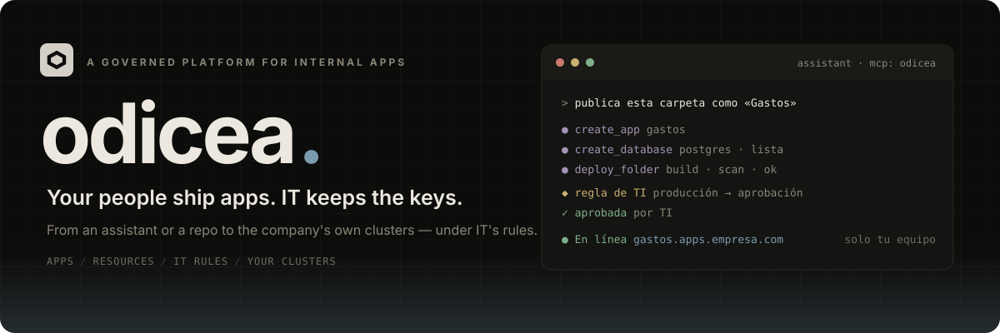

<div align="center">



# Odicea

**A governed platform for your company's internal apps.**

People build apps with their coding assistant (or push to a repo), and Odicea publishes them on the company's own clusters.<br />
IT sets the rules once — who may open what, what needs approval, which databases exist — and every app follows them.

<p>
  <a href="go.mod"></a>
  <a href="https://modelcontextprotocol.io"></a>
  <a href="agent/"></a>
  <a href="https://github.com/Abraxas-365/iamkit"></a>
  
</p>

**[Get started](#get-started)** &nbsp; · &nbsp;
**[Connect an assistant](#connect-an-assistant)** &nbsp; · &nbsp;
**[Real clusters](#publish-on-a-real-cluster)** &nbsp; · &nbsp;
**[Read the docs](#go-deeper)** &nbsp; · &nbsp;
**[Contribute](#contributing)**

</div>

---

## Internal apps, without the shadow IT

**Like Vercel, but inside the company and under IT's rules.** A builder asks their assistant to "publish this folder as Gastos". The assistant talks to Odicea's MCP. Odicea builds the code in the company's cluster, scans the image, checks IT's rules, asks for an approval if one is needed, and puts the app online behind the company sign-in.

```text
assistant ──MCP (OAuth)──▶ odyssey-api ──outbox──▶ odyssey-worker ──▶ odyssey-gateway
or GitHub push                 ▲  rules · approvals · audit                │ mTLS gRPC tunnel
                               │                                           ▼ (dialled out by the agent)
console (web) ─────────────────┘                        odyssey-agent ── in the company's cluster
                                                        build · scan · OdysseyApp → Deployment/Service/Ingress
```

<table>
<tr>
<td width="50%" valign="top">
<h3>01 · Apps</h3>
<p>Publish a folder, a container image or a GitHub repo (every push publishes). Each app has its address, a version history and a one-click <em>Volver a esta</em>. A monorepo becomes one app with several parts (web, API, workers) that ship together.</p>
</td>
<td width="50%" valign="top">
<h3>02 · Resources</h3>
<p>PostgreSQL, Redis, files and object storage from <strong>IT's catalog</strong>: versioned recipes per tier, or connections to resources the company <em>already has</em>. The app gets its connection as environment variables; secrets are references, never values.</p>
</td>
</tr>
<tr>
<td width="50%" valign="top">
<h3>03 · IT's rules</h3>
<p>Rules written in CEL decide what is allowed, denied or held for approval: publishing to production, making an app public, shipping critical vulnerabilities. Approvers work from a <em>Bandeja</em>; every change lands in a hash-chained audit log.</p>
</td>
<td width="50%" valign="top">
<h3>04 · Your clusters</h3>
<p>Apps run on the company's own Kubernetes (on-prem, AWS, GCP, Azure). An agent in each cluster dials out to the gateway — no inbound port, no cluster credentials in the control plane — and builds, scans and serves there.</p>
</td>
</tr>
</table>

**Builders ship. IT decides. The company's clusters run it.**

> [!IMPORTANT]
> **Early-stage software.** The control plane, the agent, the MCP and the console work end to end — locally on k3d and against real GitHub — but Odicea has not run a production pilot yet. APIs, CRDs and the database schema may still change. The Go module and the binaries are named `odyssey`; the product is **Odicea**.

## What a builder sees, what IT sees

| | Builder (any employee) | IT |
| :--- | :--- | :--- |
| **Console** | *Inicio* ("Necesita tu atención"), their apps, versions, sharing and configuration | *Bandeja* (approvals), *Inventario*, *Registro* (audit) and *Administración*: clusters, GitHub, rules, catalog |
| **Words** | Proyecto · Versión · Almacenamiento · "Quién puede abrirla" | The same, plus a per-user *Detalles técnicos* switch for logs, images and manifests |
| **Assistant** | Creates apps, databases and versions; asks a person to load a secret | The same MCP; IT's rules apply to every call an assistant makes |

Who may open an app is one of three modes: **team** (the app's organization, the default), **organization** (the whole company) or **public** (anyone with the link — held for IT's approval by default). The sign-in is the company's own [IAMKit](https://github.com/Abraxas-365/iamkit).

## Get started

The local stack runs Postgres and IAMKit in Docker, and the API, the worker and the console on your machine. Apps go to an **in-memory fake cluster** at first, so you can try everything without Kubernetes.

### 1. Requirements

Go (version in `go.mod`), Docker, Node with `npx`, `jq`, `openssl`, and an [IAMKit](https://github.com/Abraxas-365/iamkit) checkout (`IAMKIT_SRC` in `.env`, default `../../Desktop/Proyectos/iam`). For real clusters also `k3d`, `kubectl` and `helm`.

### 2. First run

```sh
make dev       # secrets + fleet CA + .env → Postgres + IAMKit → seed (IAMKit project, roles, demo user)
```

The seed creates the demo user **`ti@demo.local`** (role TI); its password is `DEMO_PASSWORD` in `.env`. Later, `make up` starts the containers again.

### 3. Run it on your machine

Three terminals (or tmux windows):

```sh
make run       # API on :8095 (restart it after Go changes)
make worker    # outbox, workflows and scheduled tasks; health on :8096
make web       # console on http://localhost:5178
```

Open **http://localhost:5178**, sign in with the demo user and create an app. The living design system is at **http://localhost:5178/design** (no login).

### 4. Check it end to end

```sh
make smoke     # projects + publish, auto-restore, "Volver a esta" and audit, with a real IAMKit token
make token     # a bearer token for the demo user, for your own curl calls
```

> [!TIP]
> **On the fake cluster** an image whose repository contains `unhealthy` fails its health check and one with `reject` is refused — handy to see a failed version and the automatic restore.

## Connect an assistant

Odicea offers **one MCP server** at `/mcp`, protected with OAuth: the assistant opens the browser and the person signs in with the company account, so every call carries their permissions. The console shows the exact commands under **"Conecta tu asistente"**:

```sh
claude mcp add --transport http odicea http://localhost:8095/mcp                 # Claude Code, then /mcp → odicea
codex mcp add odicea --url http://localhost:8095/mcp && codex mcp login odicea   # Codex
```

VS Code, Cursor and Antigravity get one-click install links. The **`odicea` skill** (`skills/odicea/`) teaches the assistant the workflow — preparing an app, several parts, GitHub, AI, identity, IT's rules, diagnosing a failed version — and the console gives the command that installs it.

<details>
<summary><strong>The MCP tools · what an assistant can do</strong></summary>

| Area | Tools |
| :--- | :--- |
| Who am I, what needs me | `whoami`, `get_attention` |
| Apps and parts | `list_apps`, `create_app`, `get_app`, `list_services`, `detect_services`, `set_services` |
| Publishing | `deploy_folder`, `deploy_image`, `get_deployment`, `get_build_logs`, `list_versions`, `rollback` |
| GitHub | `list_repositories`, `connect_repository`, `publish_now` |
| Configuration | `set_env`, `request_secret`, `set_access`, `enable_ai` |
| Resources | `list_catalog`, `create_resource`, `create_database`, `list_resources` |
| Approvals | `get_request`, `list_requests` |

An assistant never receives a secret's value: `request_secret` asks a person to load it in the console. When IT's rules hold a call for approval, the tool answers with the request, and `get_request` follows it.

</details>

## Publish on a real cluster

The fake cluster is enough for the console and the MCP. To build and serve for real, run the **gateway** and a local **k3d** cluster with the agent:

```sh
make gateway                     # mTLS gateway for agents on :8443 (the only holder of the fleet CA key)
make cluster                     # k3d "odyssey" + CRDs + zot registry + CloudNativePG + External Secrets
make agent-enroll NAME=local     # registers the cluster through the API; the token goes to the agent's Secret
make agent-image                 # the agent inside the cluster (it builds); `make agent` runs it on the host
make worker CLUSTER=fleet        # and `make run CLUSTER=fleet`: deploy through the tunnel
```

Apps answer at `http://<app>.apps.odyssey.localhost:8088`. The cluster's kubeconfig stays in `.dev-secrets/` (your `~/.kube/config` is not touched).

| What the agent does | How |
| :--- | :--- |
| **Builds** | From uploaded folders or GitHub commits, with Railpack or the app's Dockerfile, pushed to the cluster's registry |
| **Scans** | One Trivy job per build; the result feeds IT's rules, the inventory and the app's *Seguridad* panel |
| **Serves** | `OdysseyApp` → Deployment + Service + Ingress, with the sign-in gate in front for `team` and `organization` |
| **Makes resources** | `OdysseyResource` → CloudNativePG databases, Redis, volumes; or External Secrets for the ones the company already has |
| **Limits egress** | NetworkPolicies per app (the CNI must enforce them) |

> [!NOTE]
> **The control plane never talks to Kubernetes.** It sends the desired state through the gateway; the agent applies it and reports back. Clusters advertise capabilities (`odicea.services`, `odicea.access`, `odicea.ai`, `odicea.scan`, `odicea.egress`…), and the console only offers what the app's cluster can do.

<details>
<summary><strong>GitHub, AI for apps and other integrations</strong></summary>

### GitHub

`make github-app` registers Odicea's GitHub App through GitHub's manifest flow (it opens the browser) and writes its secrets to `.dev-secrets/github/`. With a repository connected, every push to the branch publishes the app. A public URL for the webhook is needed (for example a cloudflared tunnel).

### AI for apps

With the organization's AI gateway configured (`ODYSSEY_FREEROUTER_URL` and its key), `enable_ai` gives an app its own key and sets `OPENAI_*` and `ANTHROPIC_*` variables, so the usual SDKs work unchanged. See [docs/ai.md](docs/ai.md).

### Another IAMKit

`make iam-provision` provisions any IAMKit (staging, production) from `iam/permissions.json`; `make iam-sync` pushes manifest changes to the local one (`DRY_RUN=1`, `PRUNE=1`).

</details>

## Go deeper

| If you're here to… | Start here |
| :--- | :--- |
| Integrate over HTTP | [HTTP API](docs/api.md) (and `api/openapi.yaml`) |
| Decide who may open an app | [Access](docs/access.md) |
| Write IT's rules | [Policy](docs/policy.md), [Approvals](docs/approvals.md) |
| Offer databases and connect existing ones | [Catalog](docs/catalog.md), [Resources](docs/resources.md) |
| Handle variables and secrets | [Secrets](docs/secrets.md) |
| Give apps AI | [AI](docs/ai.md) |
| Scan images and limit traffic | [Scan](docs/scan.md), [Egress](docs/egress.md) |
| See every app and environment | [Inventory](docs/inventory.md) |
| Teach an assistant the workflow | [The `odicea` skill](skills/odicea/SKILL.md) |
| Work on the console | [frontend/README.md](frontend/README.md) |
| Understand the architecture and the rules | [AGENTS.md](AGENTS.md) |

<details>
<summary><strong>Inside the repository</strong></summary>

| Path | Responsibility |
| :--- | :--- |
| `cmd/odyssey-api` | Control-plane API, the MCP at `/mcp` and the access sign-in |
| `cmd/odyssey-worker` | Outbox delivery, workflows (`release.deploy`, builds) and scheduled tasks |
| `cmd/odyssey-gateway` | Where agents enrol and keep their mTLS gRPC tunnel; holds the fleet CA key |
| `cmd/odyssey-agent`, `agent/` | The data-plane agent: controllers for apps, builds and resources, builder, egress, secret stores |
| `internal/project` | Apps, environments and parts (the golden sample module) |
| `internal/release` | Releases, deployments and the `Cluster` port (`fake` or `fleet`) |
| `internal/fleet` | Clusters, enrolment, the fleet CA, desired state and agent reports |
| `internal/policy`, `internal/approval` | IT's CEL rules and approval requests |
| `internal/catalog`, `internal/resource` | Versioned recipes, offerings and the resources apps use |
| `internal/source`, `internal/build` | GitHub and uploaded sources; builds and their logs |
| `internal/access`, `internal/ai`, `internal/inventory`, `internal/audit` | Sign-in gate, AI keys, inventory and the hash-chained audit log |
| `internal/assistant`, `internal/mcpx` | "Conecta tu asistente" and the MCP plumbing |
| `pkg/` | Contracts shared with the agent: resource kinds and specs, detection, source archives |
| `proto/` | The fleet protocol between gateway and agent |
| `api/openapi.yaml` | The HTTP contract (checked by tests against every route) |
| `iam/permissions.json` | Permissions and roles, provisioned into IAMKit |
| `frontend/` | The console: React 19, Vite, shadcn, Tailwind v4; Spanish UI |
| `skills/odicea/` | The skill assistants download |
| `deploy/` | Local k3d registry and agent overlays, Postgres init |

Odicea is hexagonal (ports and adapters), and architecture tests enforce the layering; see [AGENTS.md](AGENTS.md).

</details>

## Contributing

Read [AGENTS.md](AGENTS.md) first: it describes the domains, the rules the architecture tests enforce and the invariants worth knowing. Never commit `.env`, `secrets/` or `.dev-secrets/`.

Useful checks from the repository root:

```sh
make check       # gofmt, vet, unit + architecture tests
make test-db     # every test, including Postgres ones, against the compose database
make web-check   # console: typecheck, lint, tests, build
make test-kube   # fleet e2e: gateway + agent on a throwaway k3s (Docker)
```

After editing `iam/permissions.json`, `proto/` or the agent's API, run `make gen`; after `api/openapi.yaml`, `make api-types`.

---

<div align="center">

**Your people ship apps. IT keeps the keys.**

[Get started](#get-started) · [Connect an assistant](#connect-an-assistant) · [Real clusters](#publish-on-a-real-cluster) · [Docs](#go-deeper)

</div>
