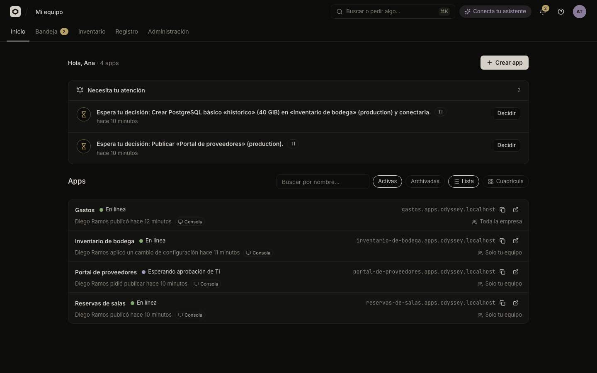

# Odicea documentation

Odicea is a governed platform for a company's internal apps: people publish with their coding assistant, IT sets the rules once, and apps run on the company's own clusters.

These pages describe the current `main` branch. Odicea is early-stage software: it works end to end on a local k3d cluster and with real GitHub, but it has not run a production pilot yet, and APIs, CRDs and the database schema may still change. Read the [known limitations](project/known-limitations.md) before relying on it.

## Choose a path

| Goal | Start here |
| :--- | :--- |
| Run Odicea on your computer and publish an app | [Your first app](tutorials/first-app.md) |
| Publish by asking Claude Code or Codex | [Publish with your assistant](tutorials/first-app-with-an-assistant.md) |
| Build and serve for real on a local Kubernetes cluster | [Your first real cluster](tutorials/first-real-cluster.md) |
| Find your way around the console (in Spanish) | [A tour of the console](guides/console-tour.md) |
| Understand apps, versions, rules and clusters | [Concepts](explanation/concepts.md) |
| **Build apps** | |
| Publish a folder or an image | [Publish an app](guides/publish.md) |
| Publish on every push to GitHub | [Publish from GitHub](guides/github.md) |
| Ship a web, an API and a worker together | [Apps with several parts](guides/several-parts.md) |
| See versions and go back to one | [Versions and going back](guides/versions.md) |
| Add a database, a cache or file storage | [Databases and storage](guides/storage.md) |
| Configure variables and secrets | [Variables and secrets](guides/variables-and-secrets.md) |
| Decide who can open an app | [Who can open an app](guides/who-can-open-it.md) |
| Know who is using your app | [Know who is using your app](guides/identity-in-your-app.md) |
| Give an app AI models | [AI for your app](guides/ai-for-apps.md) |
| Connect Claude Code, Codex, VS Code or Cursor | [Connect your assistant](guides/connect-an-assistant.md) |
| **Run it for the company (IT)** | |
| Connect a Kubernetes cluster | [Connect a cluster](guides/it/clusters.md) |
| Set up GitHub for the organization | [Set up GitHub](guides/it/github-app.md) |
| Manage people, roles and teams | [People, roles and teams](guides/it/people-and-roles.md) |
| Write IT's rules | [IT's rules](guides/it/rules.md) |
| Decide pending requests | [Approvals and the Bandeja](guides/it/approvals.md) |
| Offer databases and connect existing ones | [The catalog](guides/it/catalog.md) |
| Limit what apps reach on the internet | [Internet access from apps](guides/it/egress.md) |
| See every app and every change | [Inventory and audit log](guides/it/inventory-and-audit.md) |
| Install Odicea for a company | [Install Odicea](guides/operations/install.md) |
| **Look things up** | |
| A setting, a `make` target, an MCP tool or a permission | [Configuration](reference/configuration.md), [Make targets](reference/make-targets.md), [MCP tools](reference/mcp-tools.md), [Permissions](reference/permissions.md) |
| What a rule can read, cluster capabilities, CRDs | [Rule input](reference/rule-input.md), [Capabilities](reference/capabilities.md), [CRDs](reference/crds.md) |
| Limits and error codes | [Limits](reference/limits.md), [Errors](reference/errors.md) |
| The HTTP API | [HTTP API](api.md) |
| Know what is protected and how | [Security model](explanation/security-model.md) |
| Contribute | [Contributing](contributing/README.md), [Architecture](architecture.md) |

## How these docs are organized

- **Tutorials** walk you through a complete task with a concrete outcome, on your own computer.
- **Guides** show how to do one thing. *Build apps* is for anyone who makes apps; *For IT* covers clusters, rules, approvals and the catalog; *Operations* covers installing and running Odicea.
- **Reference** lists every setting, command, tool, permission, field and limit.
- **Explanation** describes the concepts, the life of a version and the security model.
- **Design contracts** are the detailed engineering contracts of each feature (access, secrets, resources, the catalog, AI, egress, IT's rules, approvals, scanning, the inventory). Guides link to them for the details.
- **Project** covers current limitations, the architecture and how to work on Odicea.

## A word on names

The product is **Odicea**; its code, binaries and Kubernetes resources keep the name `odyssey` (`odyssey-api`, `OdysseyApp`). The console uses plain words: an **app** is what the API calls a project, a **version** is a deployment, a **part** is one service of an app with several, and **storage** is a resource such as a database. See [Concepts](explanation/concepts.md).

The console is in Spanish. These docs name each screen in Spanish with the English meaning in parentheses: **Inicio** (Home), **Bandeja** (Inbox), **Inventario** (Inventory), **Registro** (Audit log), **Administración** (Administration), and an app's **Resumen** (Overview), **Historial** (History), **Compartir** (Sharing) and **Configuración** (Settings).

## Documentation scope

Examples use a fictional company, Andes Logística, with fictional people and `example.com` domains. Never put real hostnames, emails, tokens or keys in documentation, examples or issue reports. Engineering invariants live in [AGENTS.md](../AGENTS.md); how to write these pages is in [Contributing documentation](contributing/documentation.md).
