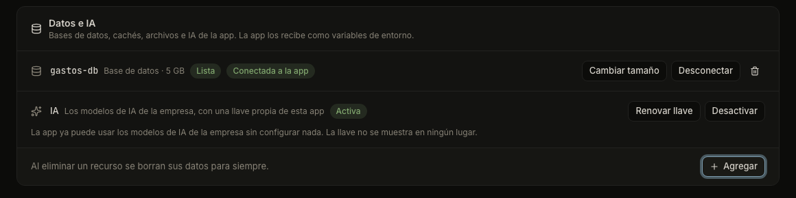

# AI for your app

Your app can use the AI models your company already pays for, such as chat and text models, with a key that belongs only to that app. Odicea makes the key, hands it to the app and renews it when you ask.

## Turn it on

AI is off by default. IT must have connected the company's AI gateway; if it has not, the console says so (for example "La IA no está disponible para esta app. Pide a TI que la habilite.") and **Activar** stays disabled.

### In the console

1. Open the app and go to **Configuración**.
2. In **Datos e IA** (Data and AI), find the row **IA** ("Los modelos de IA de la empresa, con una llave propia de esta app").
3. Press **Activar** (Turn on). In an app with several parts, a dialog **Activar la IA** asks which parts receive the key. See [Apps with several parts](several-parts.md).

The row shows **Activando…** (Turning on), then **Activa** (On). The app is published again with the new variables, and stays online while it restarts. When it is on, the console says: "La app ya puede usar los modelos de IA de la empresa sin configurar nada. La llave no se muestra en ningún lugar."



If IT's rules ask for approval to turn AI on, the request waits in the **Bandeja** until IT decides. See [Approvals and the Bandeja](it/approvals.md).

### With your assistant

```text
Dale acceso a la IA de la empresa a la app Gastos de Odicea para que resuma
los comentarios de cada gasto.
```

The assistant turns it on and writes the code that calls the models. Rotating and turning off are done in the console.

## What your app receives

While AI is on, Odicea gives the app four environment variables:

| Variable | What it holds |
| :--- | :--- |
| `OPENAI_API_KEY` | The app's own key, for OpenAI-compatible libraries |
| `OPENAI_BASE_URL` | The address of the company's AI, ending in `/v1` |
| `ANTHROPIC_API_KEY` | The same key, for the Anthropic library |
| `ANTHROPIC_BASE_URL` | The address of the company's AI, for the Anthropic library |

The official OpenAI and Anthropic libraries read these variables by themselves, so you do not have to configure anything in your code. With technical details on, the row shows the names of the variables and the address. The key is never shown anywhere.

These four names are reserved while AI is on. If your app already has a variable with one of those names, turning AI on is refused until you remove yours, and you cannot add one later.

## Use it in your code

Call the models from your app's server, never from the browser, so the key never leaves your app. Create the client with no key and no address, and name the model through a normal variable such as `AI_MODEL`, because the models available depend on your company. The list is at the AI address, under `/v1/models`.

**JavaScript**

```js
// npm install openai
import OpenAI from "openai";

const client = new OpenAI(); // reads OPENAI_API_KEY and OPENAI_BASE_URL

const r = await client.chat.completions.create({
  model: process.env.AI_MODEL,
  messages: [{ role: "user", content: "Resume este gasto: taxi al aeropuerto" }],
});
console.log(r.choices[0].message.content);
```

**Python**

```python
# pip install openai
import os
from openai import OpenAI

client = OpenAI()  # reads OPENAI_API_KEY and OPENAI_BASE_URL

r = client.chat.completions.create(
    model=os.environ["AI_MODEL"],
    messages=[{"role": "user", "content": "Resume este gasto: taxi al aeropuerto"}],
)
print(r.choices[0].message.content)
```

The Anthropic libraries work the same way: `Anthropic()` in Python and `new Anthropic()` in JavaScript read `ANTHROPIC_API_KEY` and `ANTHROPIC_BASE_URL`.

Set `AI_MODEL` as a normal variable (see [Variables and secrets](variables-and-secrets.md)). Do not write the key in your code or in a `.env` file. If a call fails with 401 or 403, the key was renewed or AI was turned off, so do not retry endlessly.

Outside Odicea these variables do not exist. Your code will fail with a clear message on your own computer. AI works once the app is published.

## Limits and spending

The console does not show how much an app has used, nor a budget. The gateway does not report use per app key, so Odicea cannot show it. Ask IT about the limits on the company's AI.

## Renew the key

**Renovar llave** (Renew key) makes a new key and swaps it in. The old key stays valid until the app runs with the new one, so there is no downtime. The console says: "Renovando la llave. La anterior deja de servir cuando la app use la nueva." Renew it if you think the key leaked, or when IT asks.

## Turn it off

Press **Desactivar** (Turn off) and confirm "¿Desactivar la IA de esta app?" The app stops receiving the key and its variables, and the key is revoked. If your code uses AI, it stops working until you turn AI on again.

If the company's AI gateway cannot be reached to revoke the key, the row shows **Llave por revocar** (Key to revoke) with a note. The app no longer uses it. Odicea retries by itself, and you can press **Reintentar** (Retry). If this stays, tell IT. You can turn AI on again meanwhile, and it gets a new key.

## Who may do what

| Action | Permission |
| :--- | :--- |
| See the state | `odyssey:projects:read` (all roles) |
| Turn on, renew, turn off | `odyssey:projects:write` (Builder, TI) |

The full list is in [Permissions](../reference/permissions.md). The technical contract is in [the AI contract](../ai.md).

## Next steps

- [Variables and secrets](variables-and-secrets.md) for `AI_MODEL`.
- [Connect your assistant](connect-an-assistant.md) to let it add AI to your app.
