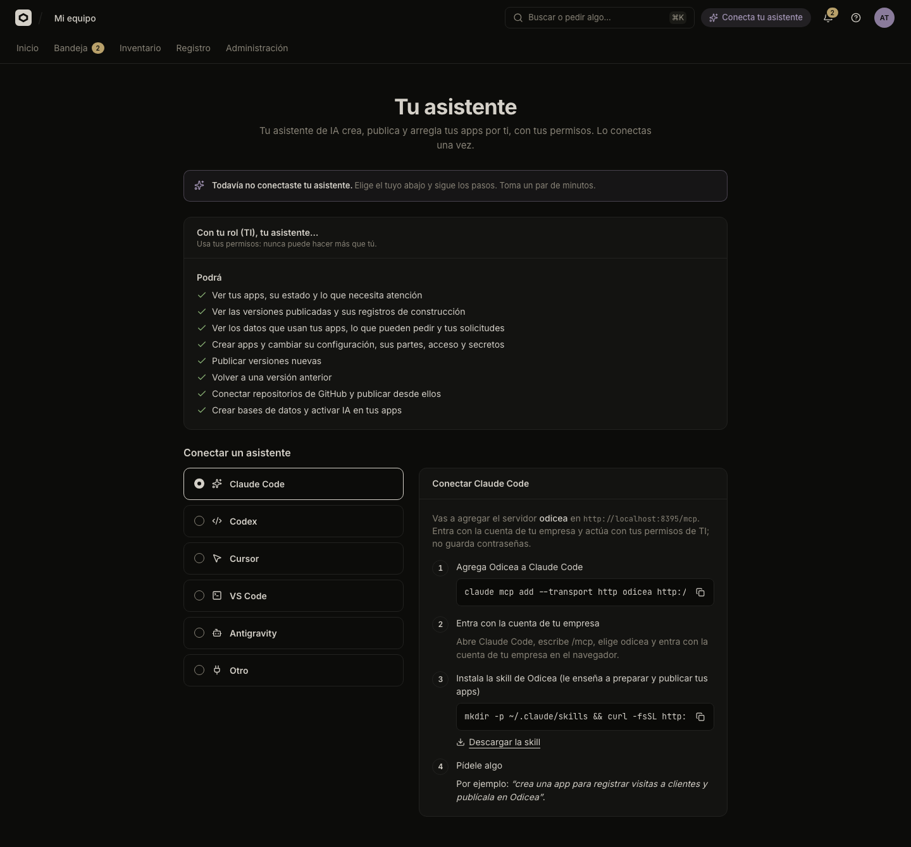

# Connect your assistant

You can connect an AI assistant such as Claude Code or Codex to Odicea. It then creates, publishes and fixes your apps for you, with the same permissions you have.

## Before you start

- IT must have turned assistants on for the company. If not, the page **Tu asistente** says "Tu equipo de TI todavía no habilitó el asistente." and you can keep publishing from the console.
- You need one of the assistants in the list installed on your computer.
- You sign in with your company account. Odicea never asks you for a password or stores one.

## Connect it

### In the console

Open **Conecta tu asistente** in the top bar (or **Conectar mi asistente** in the search palette). The page **Tu asistente** says whether one is connected.



Pick your assistant under **Conectar un asistente** and follow the four steps shown. The page uses the exact address of your Odicea:

1. **Agrega Odicea a tu asistente** (Add Odicea to your assistant). One button adds it in one click where the assistant supports it (VS Code, Cursor). Otherwise, copy the command shown.
2. **Entra con la cuenta de tu empresa** (Sign in with your company account). The assistant opens your browser and you sign in. This is a standard sign-in (OAuth): the assistant never sees your password.
3. **Instala la skill de Odicea** (Install the Odicea skill). It teaches the assistant how to prepare and publish apps. Copy the command shown, or use **Descargar la skill**.
4. **Pídele algo** (Ask it something), such as the example below.

The assistants Odicea offers are these, and each needs a slightly different step 2:

| Assistant | What to expect |
| :--- | :--- |
| **Claude Code** | Run the command; then in Claude Code type `/mcp`, choose `odicea` and sign in in the browser. |
| **Codex** | Run the command; then run `codex mcp login odicea` and sign in in the browser. |
| **VS Code** | Use the button, or the command; then in the MCP servers list (`MCP: List Servers`) start `odicea` and sign in. |
| **Cursor** | Use the button, or add the shown settings to `~/.cursor/mcp.json`; then in Cursor Settings → MCP press Connect next to `odicea`. |
| **Antigravity** | Add the shown settings to `~/.gemini/config/mcp_config.json`, restart, then in Settings → Customizations press Authenticate next to `odicea`, sign in, and paste the code it shows. |
| **Otro** (Other) | Any assistant that supports a remote MCP server over HTTP: add the address shown and sign in with OAuth. |

Cursor and Antigravity appear only when IT has registered them. If your assistant is missing from the list, ask IT.

### The skill

The skill is called `odicea`. It is a folder of instructions that the assistant reads: how to prepare an app so it builds, how to publish, what to do when something fails, and what never to do (for example, ask you to paste a secret in the chat). Install it once per computer, with the command in step 3. It is unpacked in the assistant's skills folder, for example `~/.claude/skills` for Claude Code. The page shows the skill version in technical details.

Once connected, the chip in the top bar says **Tu asistente**, and the page shows **Conectado** with the assistant, when you last used it and when you connected it.

## What the assistant can do

The page lists it under **Con tu rol (…), tu asistente…** with two lists, **Podrá** (It will be able to) and **No podrá** (It will not be able to). It uses your permissions, never more than you have. For a Builder, this is typically:

| It can | In this guide |
| :--- | :--- |
| See your apps, their state and what needs attention | [A tour of the console](console-tour.md) |
| See versions and build logs | [Versions and going back](versions.md) |
| See the data your apps use and your requests | [Databases and storage](storage.md) |
| Create apps and change settings, parts, access and secrets | [Publish an app](publish.md), [Several parts](several-parts.md), [Variables and secrets](variables-and-secrets.md), [Who can open an app](who-can-open-it.md) |
| Publish new versions and go back to an earlier one | [Publish an app](publish.md), [Versions](versions.md) |
| Connect GitHub repositories and publish from them | [Publish from GitHub](github.md) |
| Create databases and turn on AI | [Databases and storage](storage.md), [AI for your app](ai-for-apps.md) |

A reader (Lector) gets only the "see" abilities, and the chip says **solo lectura** (read-only). A permission you do not have has the matching line under **No podrá**. Some things are never done by the assistant: it does not delete data, and it does not see the values of secrets. IT's rules, such as asking for approval, apply to the assistant as they do to you.

With technical details on, the page also lists the exact tools the assistant can use. See [MCP tools](../reference/mcp-tools.md).

### Ask it

```text
Crea una app para registrar visitas a clientes y publícala en Odicea.
```

```text
La app Portal de proveedores no carga. Revisa qué pasó con la última versión y arréglalo.
```

```text
¿Qué apps de Odicea necesitan mi atención?
```

For step-by-step first use, follow [Your first app with an assistant](../tutorials/first-app-with-an-assistant.md).

## Disconnect it

On **Tu asistente**, in **Conectado**, press **Desconectar** next to the assistant and confirm "¿Desconectar …?". Its sessions end and it can no longer see or change your apps, until you connect it again. Your apps and what it already published stay as they are. An assistant that IT enabled for you says "habilitado por tu equipo de TI" instead of a connection date.

Disconnecting takes effect within seconds. If you lose a computer, disconnect from the console on another one.

## Who may do what

| Action | Permission |
| :--- | :--- |
| Use an assistant | What it can do depends on your role: it never has more permissions than you. |
| Turn assistants on for the company | The people who run Odicea (IT): see [Configuration](../reference/configuration.md) |

The permissions behind each ability are in [Permissions](../reference/permissions.md). The list of every tool is in [MCP tools](../reference/mcp-tools.md).

## Next steps

- [Your first app with an assistant](../tutorials/first-app-with-an-assistant.md)
- [Publish an app](publish.md)
