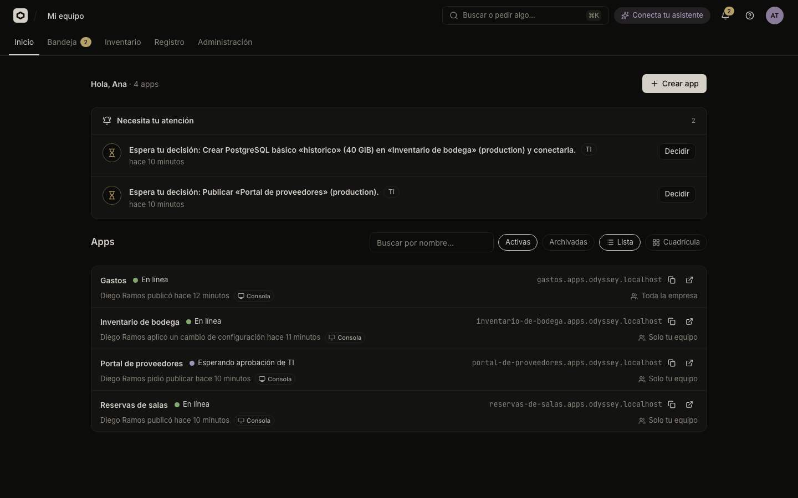
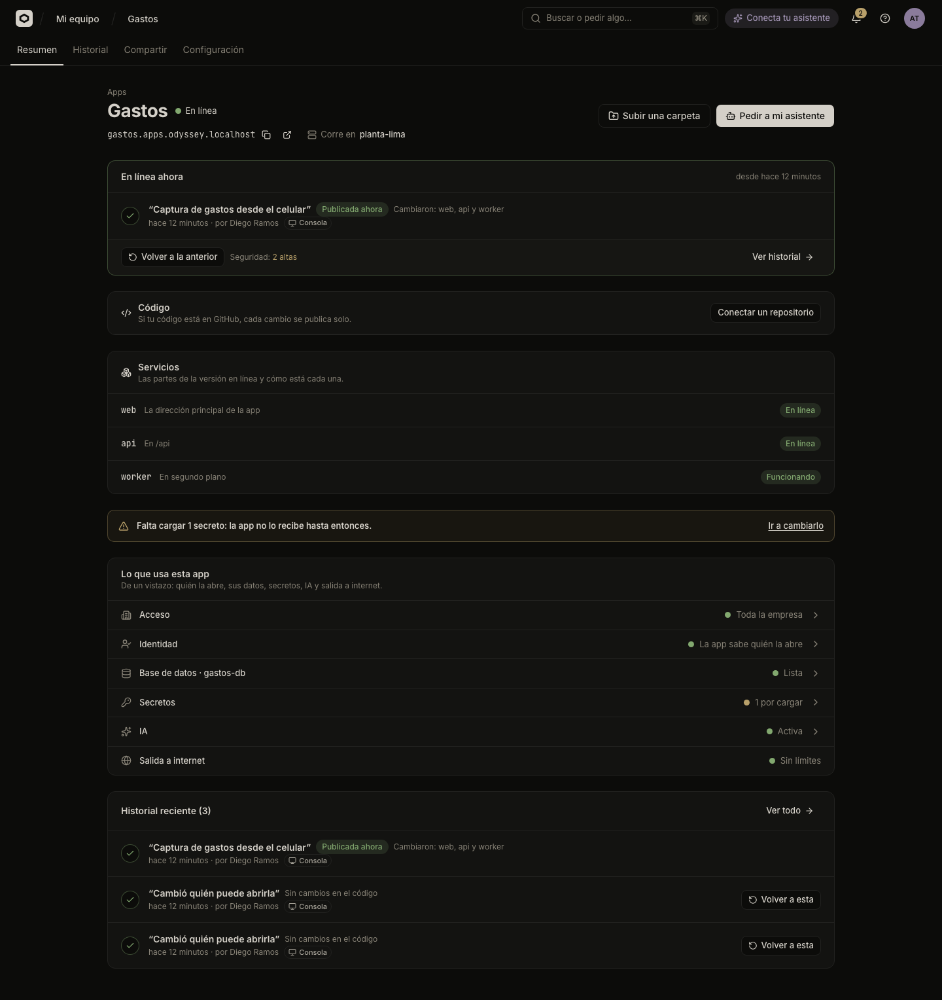
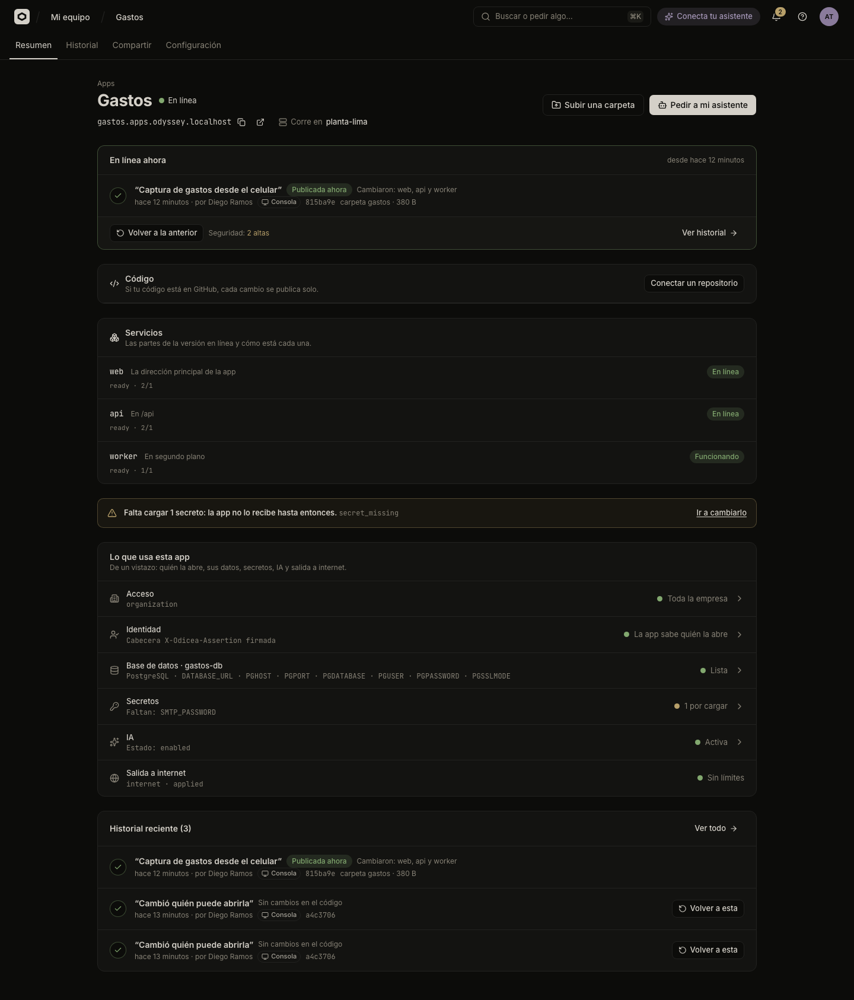

# A tour of the console

The Odicea console is where you see your apps, publish new versions, share them and follow requests. This page walks through each screen and what changes depending on your role.

The console is in Spanish. This guide names every screen and button as it appears, with the English meaning in parentheses the first time.

## Inicio (Home)

**Inicio** is the first screen after you sign in. It greets you ("Hola, Diego") and counts your apps. When everything is fine it says "todo en orden".

- **Crear app** (Create app) opens the dialog that starts a new app. You only see it if your role may change apps. See [Publish an app](publish.md).
- **Necesita tu atención** (Needs your attention) appears when something is waiting for you: a version that failed, an app with serious security findings, a request that IT decided. Each item has one button that takes you to the fix, such as **Ver qué pasó** (See what happened), **Ver solicitud** (See request) or **Conectar GitHub**. It shows at most six items; **Ver N más** shows the rest. Items for IT carry a **TI** badge.
  - For a version of yours that failed, **Pedir a mi asistente que lo arregle** (Ask my assistant to fix it) opens a dialog with a ready-made request to give to your assistant.
  - If Odicea could not check everything, it says "No pudimos revisar todo." and warns that the list may be incomplete.
- **Apps** lists your apps. **Buscar apps** filters by name. **Estado** switches between **Activas** and **Archivadas**. **Vista** switches between **Lista** (list) and **Cuadrícula** (grid); the grid also has a tile for creating an app.
- The first time, with no apps yet, you see "¿Qué quieres crear?" and **Continuar**.

## An app's page

Open an app to see its page. The header shows the app's address (with buttons to copy it and to open the app), or "Aún no tiene una versión publicada." (It has no published version yet.) It also says which cluster it runs on ("Corre en …"), and offers the main action for its state: **Subir una carpeta** (Upload a folder), **Publicar ahora desde GitHub** (Publish now from GitHub) or **Pedir a mi asistente** (Ask my assistant).

The page has four tabs:

| Tab | What it shows | Guide |
| :--- | :--- | :--- |
| **Resumen** (Summary) | What is online now, who published it and through which channel, its security result, the way back to the previous version, the code source, the parts of the app, what the app uses and the latest history. | [Versions and going back](versions.md) |
| **Historial** (History) | Every version, each with its channel and **Volver a esta** (Go back to this one). | [Versions and going back](versions.md) |
| **Compartir** (Share) | Who can open the app. | [Who can open an app](who-can-open-it.md) |
| **Configuración** (Settings) | Details, parts, variables, secrets, data and AI, and archiving. | [Variables and secrets](variables-and-secrets.md), [Databases and storage](storage.md), [AI for your app](ai-for-apps.md) |

Someone who cannot read versions sees only **Resumen** and **Configuración**.

An app with no version yet shows **Publica la primera versión** (Publish the first version) with three paths: ask your assistant, connect GitHub, or upload a folder.

The status next to an app's name is one of **En línea** (online), **Publicando…** (publishing), **Necesita atención** (needs attention), **En pausa** (no version published), **Esperando aprobación** (waiting for IT's approval) or **Archivada** (archived).

## Bandeja (Inbox)

**Bandeja** lists requests that IT's rules held for a decision, for example putting an app in front of everyone or adding a large database. In **Mis solicitudes** (My requests) you see what you asked for and where each request stands, and you can cancel one that is still waiting. A bell in the top bar opens the Bandeja and shows how many requests are waiting for you to decide, if you can decide.

People who decide requests (IT) also have **Para decidir** (To decide) with **Aprobar** / **Rechazar** and a note. See [Approvals and the Bandeja](it/approvals.md).

## Searching and the command palette

The search box at the top, **Buscar o pedir algo…**, opens the command palette. You can also open it with `Cmd+K` (macOS) or `Ctrl+K`. Type to find:

- **Ir a** (Go to): Inicio, Bandeja and the other screens you can open.
- **Apps**: your apps, to jump straight to one.
- **Acciones** (Actions): **Crear app** and **Conectar mi asistente** (Connect my assistant).
- **Administración**: the sections IT uses, if your role allows them.

## Your assistant

The chip in the top bar says **Conecta tu asistente** (Connect your assistant) until you connect one; afterwards it says **Tu asistente** with the assistant you last used. It opens the page described in [Connect your assistant](connect-an-assistant.md). If IT has not turned assistants on, the chip is hidden.

## The user menu and technical details

Your menu has **Mostrar detalles técnicos** (Show technical details, "Commit, rama, registros y variables"), the theme (**Oscuro**, **Claro** or **Como el sistema**), **Cambiar de organización**, **Tu asistente** and **Cerrar sesión**.

The console is plain by default. Technical details **add** information without changing what you can do:

- the commit, branch and author behind a version;
- the build log, open by default;
- the port and health path when you publish a folder or an image;
- the app's address as a separate field (the slug) when you create it;
- the variables each database, cache or AI key gives the app, and the technical state of each part.

The setting is remembered in your browser, per person.

## What changes by role

The console shows what your role allows and disables the rest. The roles come from [People, roles and teams](it/people-and-roles.md); the full permission list is in [Permissions](../reference/permissions.md).

| Role | What you see and can do |
| :--- | :--- |
| **Lector** (Reader) | Inicio, app pages (read only), Bandeja. No **Crear app**, no publishing, no changes. |
| **Builder** | Everything a reader sees, plus creating apps, publishing, going back to a version, changing settings and deleting data you created. Cannot make an app public. |
| **TI** (IT) | Everything, plus **Inventario**, **Registro** and **Administración** (**Clústeres**, **GitHub**, **Reglas**, **Catálogo**), deciding requests, making apps public and connecting secrets from the company's store. |

**Inventario** (Inventory) shows every app of the company and **Registro** (Audit log) every change; both are for IT. See [Inventory and audit log](it/inventory-and-audit.md).

## Next steps

- [Your first app](../tutorials/first-app.md) takes you through creating and publishing an app.
- [Publish an app](publish.md) covers the ways to get code online.
