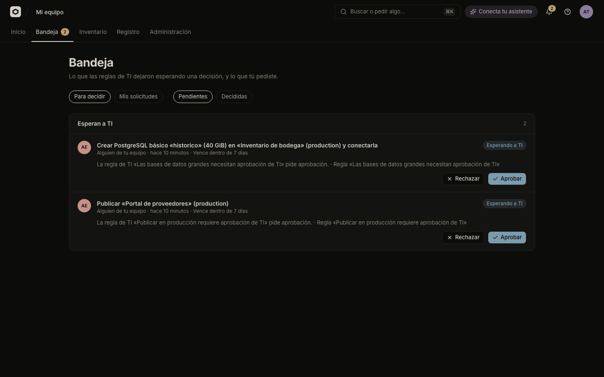

# Review and decide approval requests

See what IT's rules are holding, approve or reject it from the Bandeja (Inbox), and know what the person who asked and their assistant see meanwhile.

An `approval` rule does not refuse an action: it holds it until someone from IT decides. The contract is in [`approvals.md`](../../approvals.md). To choose which actions are held, see [Rules](rules.md).

## What holds a request

A request opens when a rule with the effect "Pide aprobación" matches an action. These are held out of the box ([Rule input](../../reference/rule-input.md#built-in-rules)):

- Publishing a version of a production app.
- Making an app public ("Cualquiera con el enlace").
- Creating or enlarging a database or files space beyond what IT's catalog pre-approves ([Catalog](catalog.md)).

Rules you write can hold any other governed action. Nothing changes until someone decides: the app stays as it was.

## Who decides

| Who | May |
|---|---|
| People with the permission `odyssey:approvals:decide` (TI by default) | Approve or reject a pending request. |
| The person who asked | Cancel their own pending request ("Cancelar"). |
| Anyone else | Nothing. They cannot see another person's request. |

- The requester can never decide their own request, even if they hold the permission.
- If several rules held the request, any one of their approver permissions is enough.
- Only a pending request can be decided. Someone else may have decided first, and you are told.

A rule's approver is a permission, `odyssey:approvals:decide` by default. The console does not edit it. See [People and roles](people-and-roles.md).

## Decide a request

To approve or reject what's waiting:

1. Open **Bandeja** in the top navigation. The bell shows how many requests wait for you, and its menu has "Abrir la Bandeja".
2. Under "Qué ver", stay on **"Para decidir"**, and under "Estado" on **"Pendientes"**.
3. Read each request: the sentence that says what is asked, who asked ("Tú", "Alguien de tu equipo", or "Un cambio en GitHub de <login>"), why (the rule's name) and when it expires.
4. Select **"Aprobar"** or **"Rechazar"**.
5. Optionally write a **"Nota"** (up to 500 characters). The person who asked reads it. Confirm.

A request opened from a notification or a link (`/bandeja?id=…`) shows on top under "La solicitud del enlace".

> [!NOTE]
> Approving does not widen what the requester can do. Odicea runs the action as the requester, with the permissions they had when they asked. If they have lost a permission since, the action fails and the request shows why. It is not rescued by the approval.

### What approving does

- **A direct action** (access, a resource, AI, services): the action runs as asked, and the approval is used up. One approval, one use.
- **A deployment**: the deployment that was `waiting_approval` continues.
- **Policy is checked again.** If you have since added a rule that denies the action, the action fails even though you approved. The request shows the error.
- If the approved action cannot run (for example the app was deleted), the request is marked approved with an error and nothing retries it. The requester asks again, and it may need a new approval.

### What rejecting does

Nothing is done, and the requester sees your note. A rejected deployment is cancelled with the reason `approval_rejected`.

## Direct actions and deployments

**Direct actions** (`set_access`, `connect_resource`, `delete_resource`, `create_resource`, `change_resource`, `enable_ai`, `set_services`) answer at once with the notice "Le pedimos a TI que lo apruebe", and nothing happens until a decision. Asking again for the same thing while a request is pending returns the existing request.

**Deployments** are accepted, then wait. A held publication appears in the app's history as **"Esperando aprobación de TI"** (status `waiting_approval`). It is held before the build. When the rules judge the scan after the build, a second hold can be opened, unless a rule already asked at the first step.

A waiting deployment holds the environment's one slot. A newer deployment or rollback of that environment replaces it and cancels its request. If the rules are later changed so that a retried deployment is allowed or denied, its request is cancelled, so nobody is asked about something that no longer needs it.

A GitHub push that a rule holds becomes a waiting deployment too, listed as "Un cambio en GitHub de <login>".

## Expiry

A request not decided within **7 days** of being asked expires. It shows as "Venció" in the decided list, with "Nadie la decidió a tiempo". Expiry is checked every 5 minutes. A waiting deployment is cancelled with the reason `approval_expired`. The requester must ask again.

## What the builder and assistant see

The builder sees the request in **Bandeja → "Mis solicitudes"**, with its status and your note. Everyone has this view, whatever their role. The states are:

| Status in the console | Meaning |
|---|---|
| "Esperando a TI" | Pending. |
| "Aprobada" | Approved. |
| "Rechazada" | Rejected, with your note. |
| "Venció" | Nobody decided in time. |
| "Cancelada" | The requester withdrew it, or a newer deployment replaced it. |

An assistant connected over MCP gets `pending_approval` and a `request_id` when an action is held, and is told to say that it is pending and not retry. It follows the request with the read-only tools `get_request` and `list_requests`, which show the status, the reason, your note, when it expires and, if approved but not done, why. The assistant cannot approve or reject anything. For a held deployment it also sees the deployment's state. See [Connect an assistant](../connect-an-assistant.md) and [MCP tools](../../reference/mcp-tools.md).

A denied action is not a request. The assistant gets the message of the rule that denied it, and is told not to look for a workaround.

> [!TIP]
> A rejection note is the only explanation the requester and their assistant get. Make it say what to do next, for example "pídelo después del lanzamiento".

## Confirmation is not approval

Before the rules are consulted, an assistant asks its own user to confirm two hard-to-undo actions: a rollback of a production app and making an app public. This asks the person, not IT. A confirmed action may then still be held by an approval rule. The console asks in its own dialogs, and never asks twice.

## Who may change it

| Action | Permission |
|---|---|
| See and decide requests | `odyssey:approvals:decide` |
| See your own requests, cancel them | Any signed-in person |
| Change which rules hold requests | `odyssey:policy:manage` |

Decisions are recorded in **Registro**. See [Inventory and audit](inventory-and-audit.md).

## See also

- [Rules](rules.md)
- [Catalog](catalog.md)
- [Rule input](../../reference/rule-input.md)
- [`approvals.md`](../../approvals.md), the full contract
- [`policy.md`](../../policy.md)
