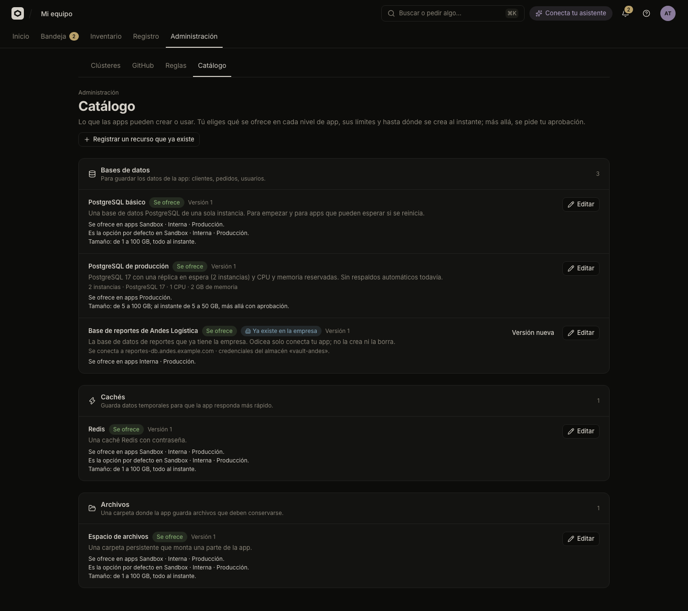

# Manage the resource catalog

Choose which databases, caches and file spaces apps can create, in which tiers, for which teams and up to what size. Register a resource the company already has.

The catalog decides what builders see under **Agregar** in an app's "Datos e IA" panel. The contract is in [`catalog.md`](../../catalog.md).

## Before you start

- You need the permission `odyssey:catalog:manage`, which TI has ([People and roles](people-and-roles.md)). Without it, **Administración → Catálogo** says "Solo TI administra el catálogo".
- To limit an option to teams, your organization's identity provider must expose teams (groups) to Odicea.
- To register a resource that reads its password from a secrets store, you also need `odyssey:secrets:external`, and a cluster that reads that store.

## What the catalog holds

The catalog is a list of **recipes**. A recipe is one way to get a resource of a kind. Open **Administración → Catálogo** to see one panel per kind:

| Panel in the console | Kind | Technical name |
|---|---|---|
| "Bases de datos" | Base de datos | PostgreSQL |
| "Cachés" | Caché | Redis |
| "Archivos" | Archivos | A persistent volume |
| "Almacenamiento de objetos" | Almacenamiento de objetos | An existing S3 bucket |

Every recipe has two parts:

- **The recipe and its versions** say what is created, for example "PostgreSQL 17 with two instances". A published version never changes. A change is a new version.
- **The offering** says where, to whom and how big. It is yours to edit.

Odicea ships four recipes. They are offered the way every resource worked before the catalog, so nothing changes until you edit them:

| Recipe | What it fixes | Offered |
|---|---|---|
| `postgres-basico` ("PostgreSQL básico") | One instance | Every tier, as the default. 1–100 GiB, all created instantly. |
| `redis-basico` ("Redis") | Nothing | Every tier, as the default. 1–100 GiB, all created instantly. |
| `files-basico` ("Espacio de archivos") | Nothing | Every tier, as the default. 1–100 GiB, all created instantly. |
| `postgres-produccion` ("PostgreSQL de producción") | 2 instances, PostgreSQL 17, 1 CPU, 2 Gi of memory | Production only, not the default. At least 5 GiB, created instantly up to 50 GiB. Default 10 GiB. |

Editing the offering is not retroactive. Resources already created keep their recipe version and size.

## Offer a recipe

To change where and how a recipe is offered:

1. Open **Administración → Catálogo** and select **"Editar"** on the recipe.
2. Turn **"Se ofrece"** on or off. Off means no app can create it. Apps that already use it keep it.
3. Under **"Versión que se ofrece"**, choose the version builders get when they create a resource. The ranges below belong to that version. After you choose another, save before editing them.
4. Under **"Niveles de app"**, tick the tiers where it is offered: "Sandbox", "Interna", "Producción". See [Rules](rules.md#tiers-nivel) for tiers.
5. For each tier, optionally tick **"Opción por defecto"**. The default is what a builder gets when they ask for "a database" without choosing. A kind has one default per tier. A tier whose default is already taken by another recipe cannot be ticked.
6. Set the limits (below) and **"Quién puede crearla"** (below).
7. Select **"Guardar"**. A message confirms "Catálogo actualizado".

### Size limits

Each sized parameter, for example the storage ("Tamaño"), has two ranges:

| Field | What it does |
|---|---|
| "Mínimo permitido" and "Máximo permitido" | Hard limits. A request outside them is refused, and nobody's approval can allow it. |
| "Al instante desde" and "Al instante hasta" | The range created without asking. A size inside the limits but outside this range waits for IT's approval, whatever the rules say. |

Example: limits 5–100 GiB and "Al instante" 5–50 GiB. A 20 GiB database is created at once, a 80 GiB one asks for approval ([Approvals](approvals.md)), and a 200 GiB one is refused.

The builder's dialog shows these ranges under each field, and a mark next to the button says whether the resource is created "al instante" or "pide aprobación". Limit errors word GiB as "GB".

### Limit an option to teams

Under **"Quién puede crearla"**:

- **"Todos"**: anyone in the organization who can create resources in an app.
- **"Solo estos equipos"**: tick the teams. Each shows how many people it has and whether it comes from the company directory.

Teams limit **creating**. A resource that already exists keeps working for everyone, and resizing it is not limited. You can pick up to 50 teams.

When two recipes are the default for the same kind and tier, the one limited to a team wins for that team's members. Two defaults that would apply to the same people cannot both be saved.

> [!NOTE]
> If Odicea cannot read the teams, "Solo estos equipos" is off, unless the recipe already has teams, which are kept. A team that no longer exists reads "un equipo que ya no existe" and matches nobody. When teams cannot be read, an offering with teams is offered to nobody.

## Register a resource the company already has

To connect a database, cache or bucket that exists outside Odicea:

1. Select **"Registrar un recurso que ya existe"** at the top of **Administración → Catálogo**.
2. Choose the **"Tipo"**. Only the types that can be existing are offered (an existing "Base de datos", "Caché" or "Almacenamiento de objetos"). A "Archivos" volume cannot be, because it lives in the cluster.
3. Fill **"Nombre"** (up to 80 characters) and optionally **"Descripción"** (up to 500). Builders see both.
4. Under "De dónde sale cada dato", answer for each variable: **"Escribirlo"** (a value such as the host or the port), **"Del almacén de secretos"** (a store, a key and optionally a property) or **"No usar"** for the optional ones. Variables Odicea builds itself, such as the connection URL, are shown without a field.
5. Check the messages under the form (below), then select **"Registrar"**.

The new recipe's id starts with `org-`, derived from the name. It is registered **off**: nobody can use it until you offer it. After you register it, the offering dialog opens so you can turn it on.

To change the connection, select **"Versión nueva"** on the recipe, edit and publish **"Publicar versión N"**. The new version is not offered until you choose it in **"Editar"**, and resources keep the version they have.

What to know:

- **Passwords and keys are never typed.** A credential (a secret variable) is only read from a store of [External Secrets](https://external-secrets.io). It never passes through Odicea. This is why registering needs `odyssey:secrets:external`. The list of stores comes from your clusters, so a mistyped name is caught here.
- **The clusters.** Only apps running in clusters that read all the stores the recipe names can use it. The form lists them. It warns if none does ("Ningún clúster lee de todos esos almacenes a la vez"). A cluster without CloudNativePG can still connect a company database. The cluster needs an agent that supports external resources (capability `existing`, see [Cluster capabilities](../../reference/capabilities.md)).
- **The network.** A private address is not reachable until you add it to the cluster's allowed egress, and with restricted egress any address must be listed. See [Control internet access](egress.md).
- **The host.** It may be private or internal, but never loopback, link-local (the cloud's metadata service), a single-label name or a name under `*.svc`, `*.cluster.local` or `*.localhost`. See [`resources.md`](../../resources.md).
- Odicea does not create it, back it up or delete it. Odicea only gives the connection to the apps you allow.

> [!IMPORTANT]
> Whoever reads the catalog without `odyssey:catalog:manage` sees the recipe but not its connection or the stores it reads.

## What builders see

In an app's "Datos e IA" panel, **Agregar** opens "Agregar a la app":

- Only the kinds offered in the app's tier and cluster, and for the teams the person belongs to. If you offer more than one recipe of a kind, the builder picks one. Otherwise they get the default.
- Each size field inside your limits.
- A mark next to the button: created "al instante", or the button reads "Pedir aprobación" ([Approvals](approvals.md)).
- For a resource the company already has: "Ya existe en la empresa: Odicea solo la conecta". It has no size and no "Cambiar tamaño", and removing it reads "Quitar": the company's data is not touched.

If nothing is offered, the dialog says "Por ahora esta app no puede agregar bases de datos, cachés ni archivos." and gives the reasons: not offered in the tier, or no cluster that can.

Assistants see the same view through `list_catalog`. See [MCP tools](../../reference/mcp-tools.md).

## Try a size before you offer it

"Probar" in [Rules](rules.md#try-a-rule) takes a catalog option and a size, so you can see what your rules say about creating or enlarging it. If the size is outside what you let be created instantly, the panel adds that the catalog asks for approval on its own.

## Who may change it

| Action | Permission |
|---|---|
| See and edit the catalog | `odyssey:catalog:manage` |
| Register a resource that reads a secrets store | `odyssey:catalog:manage` and `odyssey:secrets:external` |

## See also

- [Rules](rules.md)
- [Approvals](approvals.md)
- [Control internet access](egress.md)
- [Cluster capabilities](../../reference/capabilities.md)
- [`catalog.md`](../../catalog.md), the full contract
- [`resources.md`](../../resources.md)
- [Storage](../storage.md), the builder's view
