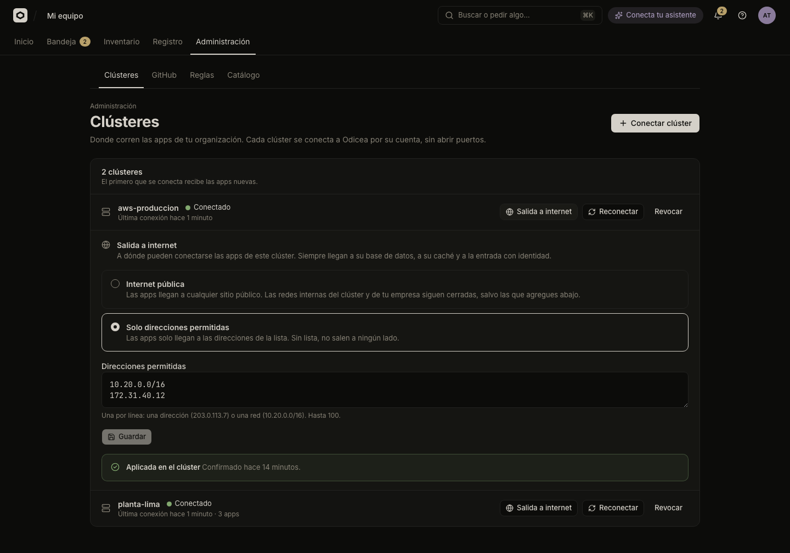

# Connect and manage clusters

Connect a Kubernetes cluster to Odicea, see its state, reconnect it when its credentials lapse, and revoke it. A cluster's agent dials out, so you open no inbound port.

You manage clusters in **Administración → Clústeres** (Administration → Clusters). The section needs `odyssey:clusters:read`; connecting, reconnecting, revoking and the egress card need `odyssey:clusters:manage`. Both belong to the TI role ([Permissions](../../reference/permissions.md)).



## How a cluster is connected

Odicea never holds a cluster's credentials and never talks to its Kubernetes API. Each cluster runs `odyssey-agent`, which opens a mutual-TLS connection **out** to `odyssey-gateway`. Odicea sends the desired state of the apps through that connection; the agent applies it and reports back. The details are in the [architecture](../../architecture.md).

Three things make the connection trustworthy:

- A **one-time enrolment token** (valid 24 hours, used once) lets a new agent ask for a certificate.
- The agent trusts only the **fleet CA** whose public-key hash (`ca-pin`) is in the same Secret as the token.
- The agent's **certificate** lasts 30 days and is renewed inside the tunnel.

## Before you start

You need:

- A running Odicea with a gateway and the fleet CA. Without `FLEET_CA_CERT` the API answers `FLEET_DISABLED` when you register a cluster. See [Install Odicea](../operations/install.md).
- `kubectl` with administrator rights on the target cluster.
- A checkout of the Odicea repository, because the console's second step applies `agent/install` from it.
- An agent image the cluster can pull (see [What the cluster needs](#what-the-cluster-needs)).
- Outbound access from the cluster to the gateway's `host:port`. The address is in the command the console shows.

## Connect a cluster

1. Open **Administración → Clústeres**. With no clusters you see "Todavía no hay clústeres" and the button **Conectar un clúster**. Otherwise use **Conectar clúster** in the header.
2. In **Nombre** enter a name, such as `lima-produccion` (up to 60 characters; unique among your clusters that are not revoked). Choose **Continuar**.
3. The dialog "Conectar *name*" shows the commands to run "con acceso de administrador al clúster (kubectl)". The token appears **once**: "Este código se muestra una sola vez." Run them in order:

   **Step 1, "Guarda el código de conexión en el clúster":**

   ```sh
   kubectl create namespace odyssey-system --dry-run=client -o yaml | kubectl apply -f -
   printf '%s' '<token>' | kubectl -n odyssey-system create secret generic odyssey-agent \
     --from-file=token=/dev/stdin --from-literal=gateway=<gateway> --from-literal=ca-pin=<ca_pin> \
     --dry-run=client -o yaml | kubectl apply -f -
   ```

   **Step 2, "Instala el agente (desde el repositorio de Odicea)":**

   ```sh
   kubectl apply -k agent/install
   ```

4. The dialog moves to "Esperando al agente…" and the console checks every 3 seconds. When the agent enrols you see **Conectado.** "Las apps de tu organización ya pueden publicarse aquí." Choose **Listo**.

If you close the dialog early with **Cerrar (sigo después)**, the cluster stays as "Esperando al agente" until the token expires. Use **Nuevo código** on its row to get another.

> [!NOTE]
> The first cluster that connects receives new apps. The panel says so under "{n} clúster(es)": "El primero que se conecta recibe las apps nuevas."

## What the cluster needs

`kubectl apply -k agent/install` creates the pieces below. They come from `agent/install/kustomization.yaml`.

| Piece | What it is |
| :--- | :--- |
| CRDs | `OdysseyApp`, `OdysseyBuild`, `OdysseyResource` (group `odyssey.dev`). See [CRDs](../../reference/crds.md). |
| Namespaces | `odyssey-system` (Pod Security `restricted`) for the agent and the sign-in gate; `odyssey-builds` (Pod Security `privileged`, because rootless BuildKit needs it) for build jobs. |
| RBAC | A service account, a ClusterRole and Roles for the agent. A `ValidatingAdmissionPolicy` limits where the agent may grant itself access to Secrets and data: only in namespaces Odicea created for an environment. It is GA from Kubernetes 1.30. |
| Agent | One `odyssey-agent` Deployment, started with `--leader-elect`. |
| Sign-in gate | An `odyssey-access` Deployment and Service that Traefik asks before it serves an app set to "Solo tu equipo" or "Toda la empresa". |

The base manifests are written for the local k3d cluster. For a real cluster, do not edit them in place; make a kustomize overlay on top of `agent/install` (`deploy/k3d/agent` is a working example). What you must set:

| Need | Why and how |
| :--- | :--- |
| **Agent image** | The manifest uses the image name `odyssey-agent` with tag `dev`. Build it with `docker build --target agent -t <registry>/odyssey-agent:<tag> .`, push it, and set it with `kustomize edit set image odyssey-agent=…`. The repository has no published agent image or release workflow, so you build and host it yourself. |
| **Apps domain** | `ODYSSEY_APPS_DOMAIN` is `apps.odyssey.localhost` and `ODYSSEY_APPS_URL_PORT` is `8088` in the base. Set your own domain, and `ODYSSEY_APPS_URL_SCHEME` and `ODYSSEY_APPS_URL_PORT` to match how users reach it. These set the app URLs the agent reports; routing a wildcard host to your ingress is up to you. |
| **Ingress controller** | Traefik in `kube-system` is the default (`ODYSSEY_INGRESS_NAMESPACE`, `ODYSSEY_INGRESS_POD_LABEL`, `ODYSSEY_INGRESS_CLASS`). The agent fences each app's pods so that only the ingress controller and the app's own namespace reach them. A wrong namespace or label breaks the apps (readiness fails). The sign-in gate also needs the `traefik.io` API, and its NetworkPolicy selects k3s's Traefik; another install overrides it in an overlay. |
| **Registry for builds** | The cluster builds uploaded sources only when `ODYSSEY_REGISTRY` is set on the agent (`host[:port][/path]`, as the nodes reach it). It is commented out in `deployment.yaml`. `ODYSSEY_REGISTRY_INSECURE=true` allows plain HTTP. Without a registry, publishing from source is refused with `NO_BUILDER`. |
| **Sign-in gate** | The gate's `ODYSSEY_ACCESS_ISSUER` is the placeholder `https://odyssey.invalid`. Set it to Odicea's public URL, set `ODYSSEY_ACCESS_ENABLED=true` on the agent, and add `ODYSSEY_ACCESS_JWKS_URL` if the cluster reaches the control plane by another address than browsers do. Until then the agent does not report `odicea.access`, and apps cannot be set to "Solo tu equipo" or "Toda la empresa". |
| **CloudNativePG** | Needed to provision Odicea-managed Postgres databases (API group `postgresql.cnpg.io`). |
| **External Secrets Operator** | Needed for secrets and company resources read from your own secret store (`external-secrets.io`, and a `ClusterSecretStore` the app names). |
| **Storage class** | A default storage class is needed to provision Postgres, Redis and files. |
| **NetworkPolicy enforcement** | The CNI must enforce NetworkPolicy, or the egress setting blocks nothing. See [Egress](egress.md). |

Every variable is in [Configuration](../../reference/configuration.md#odyssey-agent).

> [!WARNING]
> Applying `agent/install` again on a cluster whose agent you configured by overlay removes that configuration. Re-apply your overlay, not the base.

## Cluster states

Each row shows one of four states.

| State | Meaning |
| :--- | :--- |
| **Esperando al agente** | Registered, but no agent has enrolled. The row says "El código vence …" or "Sin código vigente: genera uno nuevo". |
| **Conectado** | The agent was heard from in the last 90 seconds. Agents send a heartbeat every 30 seconds. |
| **Sin conexión** | Enrolled, but not heard from for more than 90 seconds. The row says "Última conexión …" (or "Nunca se conectó"). |
| **Revocado** | Cut off for good. The row says "Revocado …". |

A row also shows how many apps run there. A revoked cluster shows "{n} apps sin versiones nuevas". The console refreshes every 30 seconds, and every 3 seconds while a cluster is waiting for its agent.

## Reconnect a cluster

Use **Reconectar** when an agent lost its identity (the Secret was deleted) or stayed offline long enough for its certificate to expire. A cluster still waiting for its first agent shows **Nuevo código** instead.

1. Choose **Reconectar** (or **Nuevo código**) on the cluster's row. The console issues a new token. A new token replaces any pending one.
2. The dialog is titled "Reconectar *name*". Run step 1 again to replace the Secret.
3. Step 2 reads "Si el agente ya está instalado, reinícialo; si no, instálalo":

   ```sh
   kubectl -n odyssey-system rollout restart deployment/odyssey-agent
   ```

Re-enrolling an active cluster makes its **previous certificate stop working** as soon as the agent enrols with the new token. If the token request fails the console says "No se pudo generar un código nuevo. Intenta de nuevo."

### How long an agent can stay offline

- A certificate lasts 30 days. The agent renews it after two thirds of its life (20 days), so an agent offline for up to about 10 days reconnects by itself.
- If an agent is offline longer than the certificate's life, or loses the answer to a renewal and stays away for more than an hour, use **Reconectar**.
- Enrolment and recovery calls (the ones made without a certificate) are rate-limited per client IP. A load balancer in front of the gateway must pass TCP through (TLS ends at the gateway) and keep the client IP, or all agents share one budget.

## Revoke a cluster

Revoking is permanent. The agent's certificate stops working at once and its tunnel closes. You cannot reconnect the same cluster; you would register it again.

1. Choose **Revocar** on the row. The dialog asks "¿Revocar *name*?" and warns "Se desconecta para siempre: su agente deja de recibir cambios y no podrás volver a conectarlo (tendrías que registrarlo de nuevo)."
2. If the cluster has apps, **Qué hacer con las apps** offers **Mover a *name*** (to another connected cluster) or **Dejarlas donde están**. Confirm with **Revocar** or **Revocar y mover**.

Apps left on a revoked cluster keep running there, but they get no new versions: publishing fails with `CLUSTER_REVOKED`. Nothing moves on its own, because the other cluster may be on another network or far from the apps' data.

To move them later, choose **Mover apps** on the revoked row ("Mover las apps de *name*"). The target agent deploys them **from scratch**. The data of databases, caches and files does **not** move. A move is refused with `RESOURCES_UNSUPPORTED` when the target's agent cannot prepare a resource the way its recipe asks.

## Egress

On an active cluster, **Salida a internet** opens the egress card. It sets what the cluster's apps may reach:

| Option | Apps reach |
| :--- | :--- |
| **Internet pública** | Public addresses, but not the private ranges, cloud metadata, the cluster's nodes or the Kubernetes API. Below it you list "Redes internas que sí pueden usar". |
| **Solo direcciones permitidas** | Only the "Direcciones permitidas" you list. With no list, nothing. |

You can list up to 100 CIDRs or addresses, and `0.0.0.0/0` is refused. After **Guardar** the card reports one of "Aplicada en el clúster", "Pendiente: el clúster todavía no la confirma", "El clúster no pudo aplicarla" or "Este clúster no puede aplicarla: actualiza su agente". The first one means the policies were written, not that traffic was tested. See [Egress](egress.md) for the model and how to test it.

## Capabilities and technical details

Each agent tells Odicea what it can do (`odicea.access`, `odicea.scan`, `odicea.egress`, a builder, a secret key, the resource kinds it can provision). Odicea refuses work that needs a capability the cluster did not announce. [Cluster capabilities](../../reference/capabilities.md) lists them and the message each missing one produces.

To read what a cluster announced, turn on **Mostrar detalles técnicos** in the avatar menu. Each cluster then shows its agent and Kubernetes versions, and **Detalles técnicos** lists ID, Kubernetes, APIs, Ingress classes, Storage classes, Certificado (serial), Vence and Conectado desde.

## Troubleshooting

| You see | Check |
| :--- | :--- |
| Stays "Esperando al agente" | The agent pod is running in `odyssey-system` and reads the Secret `odyssey-agent`. The token has not expired (24 hours). The cluster can reach the `gateway` host and port from the Secret. |
| "Sin conexión" | The agent pod is running and can still reach the gateway. If it has been down for more than about 10 days, use **Reconectar**. |
| Apps cannot be set to "Solo tu equipo" | The cluster does not report `odicea.access`: the sign-in gate is not installed or configured. |
| Publishing from source fails with `NO_BUILDER` | The agent has no `ODYSSEY_REGISTRY`. |
| The section is missing | You lack `odyssey:clusters:read`. Someone without `odyssey:clusters:manage` sees the list and "Pídeselo a quien administra la infraestructura." |

## See also

- [Install Odicea](../operations/install.md)
- [Local development](../operations/local-development.md) for the local k3d cluster, which uses its own overlay
- [Egress](egress.md)
- [Cluster capabilities](../../reference/capabilities.md)
- [Configuration](../../reference/configuration.md)
- [Security model](../../explanation/security-model.md)
