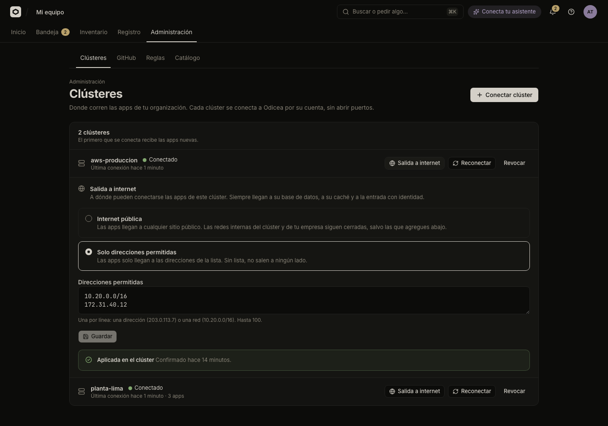

# Control internet access from apps

Decide, cluster by cluster, where the apps running there may connect. Choose open internet or a short allow list, and check that the network enforces it.

Odicea stores your choice per cluster, sends it to the cluster's agent, and the agent writes it as Kubernetes NetworkPolicies in every app namespace. The cluster's network plugin (CNI) enforces them. The contract is in [`egress.md`](../../egress.md).

## Before you start

- You need the permission `clusters:manage`, which TI has. See [People and roles](people-and-roles.md).
- The cluster must be connected and active ([Clusters](clusters.md)). A revoked cluster cannot change its policy.
- The cluster's agent must support egress (capability `odicea.egress`). If it does not, the card says "Este clúster no puede aplicarla: actualiza su agente". Your choice is stored and applies once the agent is updated. See [Cluster capabilities](../../reference/capabilities.md).

> [!IMPORTANT]
> The cluster's CNI must enforce NetworkPolicy. k3s, Calico and Cilium do, as do the managed offerings that enable it. On a CNI that ignores NetworkPolicy, the objects exist and nothing is blocked. The agent cannot tell, so "Aplicada en el clúster" means the policies were written, not that traffic was proven closed. [Test it once](#check-that-it-works) on every new cluster.

## The two modes

| Mode in the console | What apps can reach |
|---|---|
| "Internet pública" | Any public address, plus your allow list. Private networks stay closed. |
| "Solo direcciones permitidas" | Only the addresses on your allow list. With an empty list, apps reach nothing outside. |

In both modes apps always reach their own database and cache, the sign-in gate and DNS. A new cluster starts in "Internet pública", and an agent that has received no policy enforces that same mode.

### What "Internet pública" keeps closed

"Internet pública" is not "everything". These ranges stay closed unless you list them:

- Private networks: `10.0.0.0/8`, `172.16.0.0/12`, `192.168.0.0/16`, and their IPv6 counterpart `fc00::/7`.
- The cloud's metadata service (`169.254.169.254`) and other link-local, loopback, multicast and reserved ranges.
- The cluster's own nodes, by address. This keeps apps away from each node's kubelet, its node ports and, on a control-plane node, the Kubernetes API. The agent re-reads the nodes every 2 minutes, so a node that joins is fenced within that time.
- Other namespaces and the cluster's internal Kubernetes API address.

The exact list is in [`egress.md`](../../egress.md#what-internet-keeps-closed).

> [!WARNING]
> A managed cluster (EKS, GKE, AKS and similar) often has a public API address that is not a node. In "Internet pública" an app can reach that address, and it would still need a valid credential to do anything. Odicea has no way to deny one public address. If that matters to you, use "Solo direcciones permitidas" and list what the apps need.

## Choose a mode

To change what the apps of a cluster may reach:

1. Open **Administración → Clústeres**.
2. On the cluster's row, select **"Salida a internet"**. The card opens under the row.
3. Choose **"Internet pública"** or **"Solo direcciones permitidas"**.
4. Edit the list (see [below](#add-an-allowed-address)). In "Internet pública" the field is called "Redes internas que sí pueden usar". In "Solo direcciones permitidas" it is "Direcciones permitidas".
5. Select **"Guardar"**.

The state under the form tells you whether the cluster applied it:

| State | Meaning |
|---|---|
| "Pendiente: el clúster todavía no la confirma" | Saved and sent. It should confirm in seconds. If the cluster is offline, it applies when the cluster returns. |
| "Aplicada en el clúster" | The agent wrote the policies and confirmed. |
| "El clúster no pudo aplicarla" | The agent could not apply it, and the card shows what it said. Check the agent. |
| "Este clúster no puede aplicarla: actualiza su agente" | The agent predates egress control. |

The "Salida a internet" button only shows on active clusters. Saving the same setting again changes nothing.



## Add an allowed address

To let apps reach something on your network, such as an internal LLM gateway, a database or a partner API:

1. Open the cluster's **"Salida a internet"** card.
2. In the list, write one entry per line: an address (`203.0.113.7`) or a network (`10.20.0.0/16`). You can list up to 100.
3. If an entry is private or overlaps the cluster's own ranges, the console asks you to confirm: "Esta dirección es interna del clúster o de tu red: las apps podrán llegar a ella". Choose **"Sí, permitirlas"** if it is what you want.
4. Select **"Guardar"**.

The list is open to every app on the cluster. It is an exception to the mode, so it works in both.

- You cannot allow `0.0.0.0/0` or `::/0`. The mode "Internet pública" already means all public addresses. Allowing everything, private included, is not offered: list the private range you need.
- An entry that contains a node's address is saved, because you asked for it, but the card shows a yellow **"Revisa estas direcciones"** warning. Apps will be able to reach that node's kubelet and, on a control-plane node, the Kubernetes API.
- To remove an entry, delete its line and save. **"Descartar cambios"** reverts the form.

> [!NOTE]
> You do not list the AI gateway. When an app uses the AI, the agent opens the gateway for that app only, in either mode. See [AI for apps](../ai-for-apps.md).

## What the agent creates

In each environment's namespace the agent keeps four NetworkPolicies, and restores them if someone edits or deletes one (it checks every 2 minutes):

| Policy | Covers |
|---|---|
| `odicea-apps` | App pods: egress by the mode and list, ingress only from the ingress controller and their own namespace. |
| `odicea-resources` | Databases and caches: connections only from the apps of the namespace and the database operator. |
| `odicea-default` | Any other pod in the namespace: DNS and its own namespace only. A pod nobody labelled is closed, not open. |
| `odicea-ai` | Only while an app uses AI: egress to the AI gateway for the pods that use it. |

You can see them with `kubectl get networkpolicy -n odyssey-<environment id>`. Builds have their own policy and are not affected.

A cluster with a different ingress controller than Traefik in `kube-system` sets the agent's `ODYSSEY_INGRESS_NAMESPACE` and `ODYSSEY_INGRESS_POD_LABEL` (and `ODYSSEY_DNS_NAMESPACE`, `ODYSSEY_DNS_POD_LABEL`, `ODYSSEY_OPERATOR_NAMESPACE` for DNS and CloudNativePG). Wrong values break the app, because its readiness fails, instead of leaving it open. See [`egress.md`](../../egress.md).

## Check that it works

On a new cluster, run these from a pod of an app (or an ephemeral container with its labels):

```sh
curl -sS -m5 https://example.com                              # internet mode: works
curl -sS -m5 http://169.254.169.254/                          # must be blocked (timeout)
curl -sSk -m5 https://kubernetes.default.svc/                 # must be blocked
curl -sS -m5 http://odyssey-access.odyssey-system.svc:8099/   # works
```

If either of the blocked ones answers, the CNI is not enforcing NetworkPolicy.

## What builders see

In an app's **Resumen** tab, the card "Lo que usa esta app" has a "Salida a internet" row:

| Row says | Means |
|---|---|
| "Sin límites" | The cluster is in "Internet pública". |
| "Solo a lo permitido por TI" | The cluster limits access and the agent confirmed it. |
| "Limitada, sin confirmar todavía" | The cluster limits access, but the agent has not confirmed it. |
| "Aún sin clúster" | The app has no cluster yet. |

Builders cannot change the setting. The rows tell them it is IT's decision.

## Who may change it

| Action | Permission |
|---|---|
| See a cluster's egress policy | `clusters:read` |
| Change it | `clusters:manage` |

Every change is recorded in **Registro** as `cluster.egress_changed`, with the new and previous mode and list. See [Inventory and audit](inventory-and-audit.md).

## See also

- [Clusters](clusters.md)
- [Cluster capabilities](../../reference/capabilities.md)
- [`egress.md`](../../egress.md), the full contract
- [Security model](../../explanation/security-model.md)
