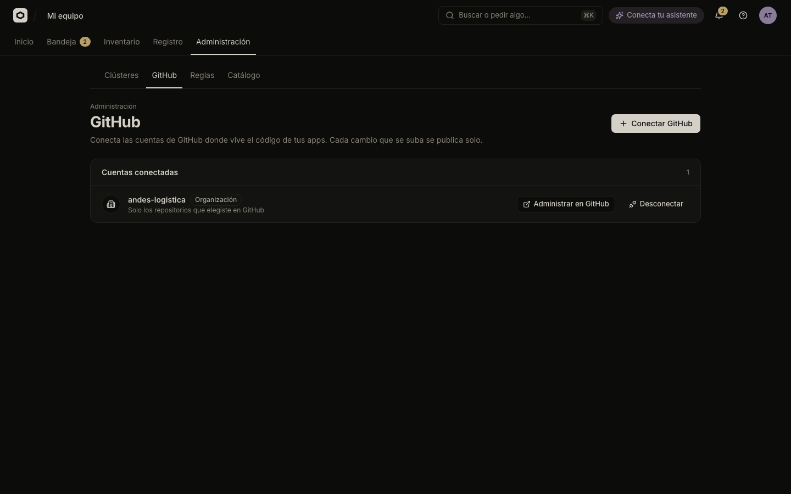

# Set up the GitHub App

Register Odicea's GitHub App for your company, give the API its credentials, and install it on your GitHub organization so apps can publish from repositories. This is done once by whoever runs the Odicea server, then IT connects accounts in the console.

Builders connect a repository to an app from the app itself. This page covers the company-wide part: the App, its webhook, and **Administración → GitHub** (Administration → GitHub).



## What the App does

Once an app is connected to a repository and branch, every push to that branch publishes a new version. Odicea also writes a commit status back to GitHub. It does this with a GitHub App, not with personal tokens.

The App asks GitHub for these repository permissions and event (from the manifest the CLI sends):

| Setting | Value | Used for |
| :--- | :--- | :--- |
| `contents` | read | Downloading the code at a commit. |
| `metadata` | read | The basics every App gets. |
| `statuses` | write | Commit statuses. |
| `members` | read | Checking that the person who installs the App administers the GitHub organization. |
| Event `push` | subscribed | Publishing on push. |

Installation events (`installation`, `installation_repositories`) are always delivered to a GitHub App. Odicea uses them to refresh, suspend or unlink an installation, and to disconnect apps whose repository was removed from it. If a webhook is lost, a poll every 2 minutes catches the branch's new commit anyway.

## What you need

- A public URL where GitHub's servers and your users' browsers reach the API. Webhook deliveries and the install callback both go there. This page calls it `<public-url>`, for example `https://odicea.example.com`.
- A GitHub account that can create Apps for the owner you choose (a personal account, or an organization you own).
- Access to a machine with the Odicea source and Go, to run the registration command, and a browser.

## Register the App

The command `odyssey-api github-app create` registers the App through GitHub's manifest flow. In the repository, `make github-app` runs it, and `ARGS` passes the flags:

```sh
make github-app ARGS="--org andes-logistica --public-url https://odicea.example.com"
```

It starts a small server on `127.0.0.1`, opens your browser on it (if your system has `open` or `xdg-open`; otherwise it prints the address), and waits up to 10 minutes. In the browser you confirm the App on GitHub with **Create**. GitHub then sends the App's credentials back to the command.

| Flag | Default | Meaning |
| :--- | :--- | :--- |
| `--public-url` | `http://localhost:8095` | The API's public base URL. The webhook and the setup callback hang off it. |
| `--webhook-url` | `<public-url>/webhooks/github` | Where GitHub delivers webhooks, when it differs. |
| `--org` | your personal account | GitHub organization that owns the App. |
| `--name` | `Odicea` | The App's name. |
| `--out` | `.dev-secrets/github` | Directory the secrets are written to. |
| `--github-url`, `--api-url` | `https://github.com`, `https://api.github.com` | For GitHub Enterprise Server. |
| `--listen` | `127.0.0.1:0` | Address of the local server that receives GitHub's redirect. |
| `--force` | off | Overwrite existing secret files. Without it the command refuses. |

The command writes four files, each with mode `0600`, in the output directory:

| File | Holds |
| :--- | :--- |
| `private-key.pem` | The App's private key. |
| `webhook-secret` | The secret that signs webhook deliveries. |
| `client-secret` | The OAuth client secret. |
| `github.env` | The variables below, pointing at those files. |

> [!IMPORTANT]
> The manifest registers the App as **not public**, so only the account that owns it can install it. Install it on that same GitHub organization.

> [!NOTE]
> The default output directory `.dev-secrets/` is for development. For a production server, pass `--out` a directory outside the repository, then move the secrets to wherever your platform keeps them (a secret store, files mounted into the containers).

## Give the API and the worker the credentials

GitHub stays off until `GITHUB_APP_ID` is set. When it is set, the others below are required too, or the process refuses to start. Secrets are always files, never values.

| Variable | Meaning |
| :--- | :--- |
| `GITHUB_APP_ID` | The App's numeric id. |
| `GITHUB_APP_SLUG` | The App's name in `github.com/apps/<slug>`. |
| `GITHUB_APP_PRIVATE_KEY_FILE` | Path to the RSA private key (PEM). |
| `GITHUB_WEBHOOK_SECRET_FILE` | Path to the webhook secret. |
| `GITHUB_CLIENT_ID` | The OAuth client id, which verifies who comes back from installing the App. |
| `GITHUB_CLIENT_SECRET_FILE` | Path to that client's secret. |
| `GITHUB_API_URL`, `GITHUB_URL` | Only for GitHub Enterprise Server (`https://<host>/api/v3` and `https://<host>`). |
| `ODYSSEY_STATE_KEY_FILE` | Optional. A key (at least 16 bytes) that signs the install state. Without it, one is derived from the webhook secret. |

`github.env` already contains the first six, with absolute paths on the machine where you ran the command. Adapt the paths to where the files live in your deployment. Both `odyssey-api` and `odyssey-worker` read these settings, so give the same values to both and restart them. `make run` and `make worker` do not load `github.env` by themselves; for a local run, load it first (`set -a; source .dev-secrets/github/github.env; set +a`).

Also set `ODYSSEY_CONSOLE_URL` to the console's public URL: the install callback sends the browser back there. See [Configuration](../../reference/configuration.md#github).

## The URLs GitHub uses

All are on `<public-url>`, the API:

| Purpose | URL |
| :--- | :--- |
| Webhook | `<public-url>/webhooks/github` |
| Setup and callback | `<public-url>/github/setup` |

Both routes are public: no token, no CORS. The webhook is accepted only when the `X-Hub-Signature-256` header matches the webhook secret. A reverse proxy in front of the API must let both paths through. GitHub must be able to reach the webhook. When it cannot (a laptop, a private network), use a tunnel and put its address in `--public-url`, or edit the App's webhook URL on GitHub.

## Install the App on your organization

You need `odyssey:integrations:manage` (the TI role) to connect accounts.

1. Open **Administración → GitHub**. If GitHub is not configured you see "GitHub aún no está disponible". With **Mostrar detalles técnicos** on, the page shows the command to run.
2. Choose **Conectar GitHub**. The button says "Abriendo GitHub…" and the browser goes to GitHub.
3. Pick the account (for example the `andes-logistica` organization) and the repositories to share: all of them, or only some.
4. GitHub sends you back to the console, which shows "Conectando tu cuenta de GitHub…". The account then appears under **Cuentas conectadas**.

If you are not an owner of the GitHub organization, GitHub asks an owner to approve the installation, and the console shows "Falta una aprobación." The owner approves on GitHub; then repeat the steps.

### What an account row shows

| Element | Meaning |
| :--- | :--- |
| **Organización** or **Cuenta personal** | The kind of GitHub account. |
| **Suspendida** | GitHub suspended it. Its repositories cannot be published until it is reactivated. |
| "Todos los repositorios" or "Solo los repositorios que elegiste en GitHub" | What the installation can read. |
| **Administrar en GitHub** | Opens the installation on GitHub, where you change which repositories it reaches or uninstall the App. |
| **Desconectar** | Unlinks the account from Odicea. |

**Desconectar** asks "¿Desconectar *account*?" It explains that apps connected to its repositories stop publishing by themselves, while what is already online keeps working. To remove Odicea from GitHub itself, use **Administrar en GitHub**.

## Errors when connecting

The console shows "No se pudo conectar GitHub." followed by one of these:

| Message (code) | Cause |
| :--- | :--- |
| "El enlace para conectar GitHub venció o no es tuyo. Vuelve a intentarlo desde Odicea." (`GITHUB_STATE_INVALID`) | The link expired (claims last 15 minutes) or belongs to another person or organization. |
| "Tu cuenta de GitHub no administra esa instalación: debe instalarla quien es dueño de la cuenta u organización en GitHub." (`GITHUB_NOT_YOURS`) | The GitHub user is not the owner of the account, or an active admin of the organization. |
| "Esa cuenta de GitHub ya está conectada a otra organización de Odicea." (`GITHUB_INSTALLATION_TAKEN`) | One GitHub installation links to a single Odicea organization. |
| "GitHub no respondió. …" (`GITHUB_UNAVAILABLE`) | GitHub did not answer. Try again. |
| "GitHub no está configurado en Odicea. Pide a TI que lo configure." (`GITHUB_NOT_CONFIGURED`) | The API has no `GITHUB_APP_ID`. |

## Troubleshooting

| Symptom | Check |
| :--- | :--- |
| Pushes do not publish | In the App's settings on GitHub, open Advanced and read the recent deliveries. A `401` means the webhook secret differs from `GITHUB_WEBHOOK_SECRET_FILE`. No deliveries means GitHub cannot reach `<public-url>/webhooks/github`. |
| The API will not start | The message `GITHUB_APP_ID is set; also required: …` lists the missing variables. |
| The section "GitHub" is missing from Administración | You lack `odyssey:integrations:manage`. |
| You changed the public URL | Update the webhook URL, the setup URL and the callback URL in the App's settings on GitHub. |

## See also

- [Configuration](../../reference/configuration.md#github)
- [Install Odicea](../operations/install.md)
- [Local development](../operations/local-development.md#real-github-through-a-tunnel)
- [Connect a repository to an app](../publish.md)
- [People and roles](people-and-roles.md)
