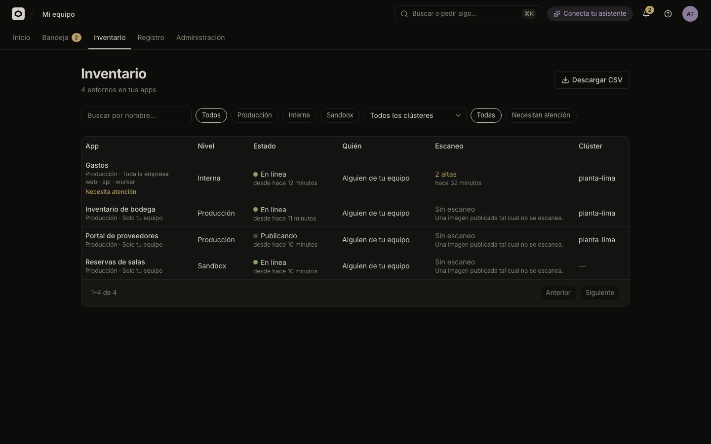
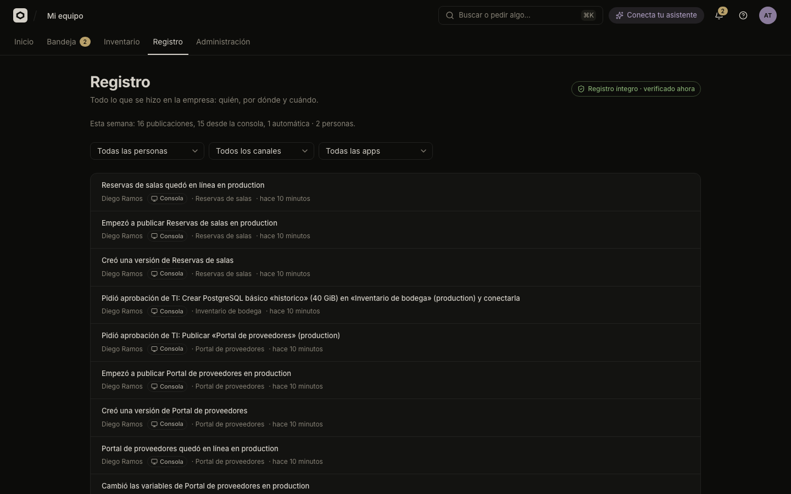

# Inventory and audit log

See everything your organization runs in Inventario, and everything that happened in it in Registro, a tamper-evident log. Both pages are only for TI.

Both need a permission that only the TI role has: `odyssey:inventory:read` for Inventario and `odyssey:audit:read` for Registro ([Permissions](../../reference/permissions.md)). Anyone else who opens them sees a message that only TI can.

## Inventario

Open **Inventario** in the console's top navigation. It lists every app of the organization, one row per app and environment, with the state of the version online and the result of its last vulnerability scan. The header counts the rows, for example "3 entornos en tus apps".

### What a row shows

| Column | Shows |
| :--- | :--- |
| **App** | The app's name (a link to the app) and under it the environment ("Producción" or the environment's slug) and who can open it. The app's slug appears with **Mostrar detalles técnicos** on. An app of several parts lists them. "Necesita atención" appears when the app has something pending for people or TI, or when its last publication failed. |
| **Nivel** | The app's tier: **Sandbox**, **Interna** or **Producción**. |
| **Estado** | "Sin publicar", "Publicando", "En línea" (with "desde …") or "No se publicó". |
| **Quién** | The person who created the app: "Tú" or "Alguien de tu equipo". The console shows no names here; the CSV has an id. |
| **Escaneo** | The scan of the version online: "Sin escaneo", "Escaneando…", "No se pudo escanear", "Sin vulnerabilidades graves", or a count such as "1 crítica, 2 altas". See [Scan](../../scan.md). |
| **Clúster** | The cluster that runs it. |

If Odicea could not read a part of a row (the scan, the cluster, what the app uses, resources, secrets, AI or egress), the row says "No pudimos leer … ahora." instead of guessing. A row never shows a clean scan it did not read.

### Filters

| Filter | Options |
| :--- | :--- |
| **Buscar apps** | By name or slug. |
| **Nivel** | Todos, Producción, Interna, Sandbox. |
| **Clúster** | Todos los clústeres, or one. Offered only if you can read clusters (`odyssey:clusters:read`, which TI has). |
| **Atención** | Todas, or Necesitan atención. |

Pages have 25 rows, with **Anterior** and **Siguiente**.

> [!NOTE]
> One read looks at up to 500 apps. If your organization has more, the page says "Hay más apps de las que se revisan a la vez." Use the filters to narrow the list. The CSV follows the same rule.

If the clusters cannot be read while you filter by cluster, you get "No pudimos leer los clústeres ahora." and not "No hay entornos que coincidan": an empty list would be a false answer.

### Download a CSV

**Descargar CSV** exports **every row that matches the filters**, not only the page you see. The file is `inventario.csv`, UTF-8 with a byte-order mark so Excel reads accents correctly. Cells that a spreadsheet could read as a formula (starting with `=`, `+`, `-`, `@`, a tab or a carriage return) are prefixed with an apostrophe.

The columns are, in order: App, Entorno, Dueño, Nivel, Acceso, URL, Estado, Versión en línea, En línea desde, Recursos, Usa IA, Secretos, Secretos por cargar, Escaneo, Críticas, Altas, Clúster, Necesita atención, Servicios. Dueño is the creator's id.

When the file is ready the console says "Descargamos el inventario.", or warns that it is incomplete (more apps than fit, or clusters unavailable).

> [!NOTE]
> The needs-attention filter and the CSV read what each environment uses, one by one. They are the heaviest requests; on an organization near 500 apps expect seconds. Use them occasionally.

The API behind it is described in [Inventory](../../inventory.md).

## Registro

Open **Registro**. Its description reads "Todo lo que se hizo en la empresa: quién, por dónde y cuándo." Every action in Odicea becomes one entry: apps created, versions published (from the console, an assistant or GitHub), changes to who can open an app, approvals, and IT rules.

### What is recorded

Every domain event is written to the log, because the log is a subscriber of all of them. Nothing in Odicea writes to it by hand. The event families include projects, environments, releases and deployments, builds and scans, access changes, secrets (the names, never the values), resources, AI settings, approvals, policy rules, catalog changes, GitHub connections and pushes, and clusters (created, enrolled, connected, certificate renewed, egress changed, revoked, apps moved).

Each entry has:

| Field | Meaning |
| :--- | :--- |
| Summary | One sentence in plain language. |
| Who | "Tú", the person's name, "GitHub" for a push nobody pressed, "La plataforma" for Odicea's own actions (automatic restore, schedules, a cluster's agent), or "Alguien de tu equipo" if the directory does not know the person. |
| Channel | Where it came from: **Consola**, an assistant, **GitHub** or **Automático**. Entries from before the channel was recorded show "Canal no registrado". |
| When | Relative time. |
| App | A link to the app the entry is about. |

With **Mostrar detalles técnicos** on, each entry also shows its sequence number, event type, hash, correlation id and payload, and a link to see the whole chain it belongs to. Values of secrets never reach the log: only their names do.

Above the list, a line summarises the last seven days, for example "Esta semana: 12 publicaciones, 9 con un asistente, 3 desde GitHub · 4 personas." With no activity it says "Esta semana no hubo actividad."

### Filters

| Filter | Options |
| :--- | :--- |
| **Persona** | Todas las personas, or one of the people who have entries. |
| **Canal** | Todos los canales, Consola, Cualquier asistente, a named assistant, Otro asistente, GitHub, Automático, Canal no registrado. |
| **App** | Todas las apps, or one app. |
| **Toda la cadena de …** | Technical mode only: shows every entry of one operation (the same correlation id). |

**Quitar filtros** clears them. The filters live in the page address, so you can share a link to a narrowed view. Pages have 25 entries, newest first, with **Más recientes** and **Anteriores**.

### How tamper evidence works

The log is **append-only** and **hash-chained**, one chain per organization:

- Each entry's hash is a SHA-256 over its content and the previous entry's hash. Changing or deleting an old entry breaks every hash after it.
- A database trigger rejects `UPDATE`, `DELETE` and `TRUNCATE` on the table. A database administrator can still remove the trigger, but the chain would then no longer verify.
- Recording the same event twice does nothing, so a retry never duplicates an entry.

Odicea re-hashes the whole chain when you open the page and again every 5 minutes while it stays open. The result shows as a seal in the header:

| Seal | Meaning |
| :--- | :--- |
| "Registro íntegro · verificado …" | The chain is intact. |
| "Verificando…" | Checking. |
| "No pudimos verificar el registro" | The check failed to run, not that it found a problem. Retry. |
| "Registro alterado" | The chain does not match. |

When the seal says "Registro alterado", a banner names the first entry that no longer matches (`#<number>`). Entries before it are still reliable. Someone changed or deleted history directly in the database, bypassing Odicea. Tell whoever handles information security in your company and **do not fix anything by hand**: what is stored now is the evidence.

> [!NOTE]
> The hash chain proves that history was altered. It does not prevent someone with database access from altering it, and it cannot restore what was lost. Protect and back up the database as you would any audit record.

## See also

- [Security model](../../explanation/security-model.md)
- [Permissions](../../reference/permissions.md)
- [Inventory contract](../../inventory.md)
- [Scan](../../scan.md)
- [Approvals](approvals.md)
- [People and roles](people-and-roles.md)
