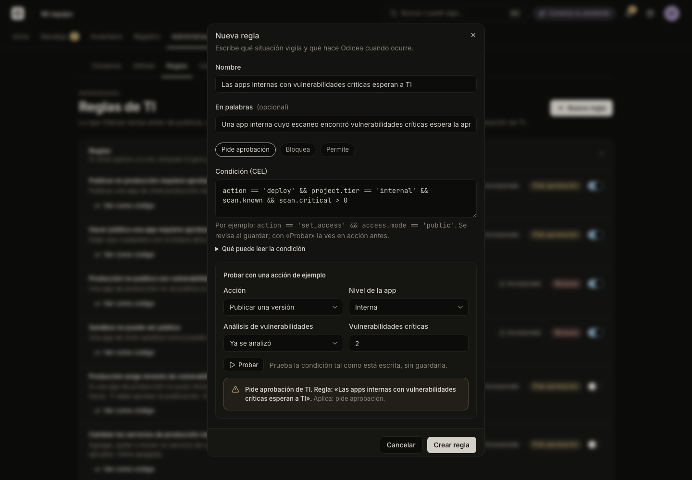

# Write and manage IT rules

Set the rules Odicea checks before publishing, opening an app to more people or connecting data. Write your own, try them without risk, and switch built-in ones off.

Every rule either blocks an action or holds it until someone from IT approves it. The full contract is in [`policy.md`](../../policy.md). The variables a rule can read are in [Rule input](../../reference/rule-input.md).

## Before you start

- You need the permission `odyssey:policy:manage`, which TI has ([People and roles](people-and-roles.md)). Without it, **Administración → Reglas** says "Solo TI puede ver las reglas".
- Rules are written in [CEL](https://cel.dev), a small expression language: one condition that is true or false. The console shows what a rule can read under "Qué puede leer la condición".
- Rules judge each app by its **Nivel** (tier), so set it first.

## Tiers ("Nivel")

Every app has a tier that says how important it is. Rules lean on it, for example "publishing in production needs approval".

| Tier in the console | In a rule | Meaning |
|---|---|---|
| Sandbox | `sandbox` | For trying things. Rules are usually the strictest about what is published outward. |
| Interna | `internal` | A company tool. Every new app starts here. |
| Producción | `production` | Serves customers or critical processes. |

To change an app's tier:

1. Open the app and select its **Configuración** tab.
2. In "Detalles", open the **Nivel** menu and choose the tier.

Only people with `odyssey:projects:tier` see the menu, which is TI by default. Everyone else sees the tier as text. It changes what the rules do from then on.

## See the rules

Open **Administración → Reglas**. Each rule is a row with:

- A switch that turns it on or off.
- A badge for its effect: "Pide aprobación" (held for IT), "Bloquea" (blocked) or "Permite" (allowed).
- An "Incorporada" badge for built-in rules.
- **"Ver como código"**, which shows its condition and a "Probar" panel.

## How rules combine

Odicea evaluates every enabled rule each time someone tries a governed action:

1. If any rule that matches blocks, the action is blocked.
2. Otherwise, if any matching rule asks for approval, the action waits for IT.
3. Otherwise it goes ahead. No matching rule means allowed.

A rule with the effect "Permite" never overrides the other two. A rule that cannot be evaluated counts at its own strength: a blocking rule blocks, an approval rule asks, and an "allow" rule is ignored. Switched-off rules are not evaluated. See [Rule input](../../reference/rule-input.md#verdicts-and-precedence).

## Write a rule

To create a rule:

1. Open **Administración → Reglas** and select **"Nueva regla"**.
2. Fill **"Nombre"** (up to 200 characters). Example: "Los datos de clientes necesitan aprobación".
3. Optionally fill **"En palabras"** (up to 500 characters): a sentence saying what the rule does. The list shows it instead of the name.
4. Under **"Qué hace la regla"**, choose "Pide aprobación", "Bloquea" or "Permite".
5. In **"Condición (CEL)"**, write the condition. Up to 2000 characters. The rule applies when it is `true`.
6. Select **"Probar"** to see it in action before you save (see [below](#try-a-rule)).
7. Select **"Crear regla"**.



If the condition has a mistake, saving is refused and the message points at the "Condición (CEL)" field. A new rule is on right away. You can have up to 100 rules.

Who may decide the requests an approval rule creates is covered in [Approvals](approvals.md).

### Examples

#### Public apps need approval

To require approval when an app is opened to anyone with the link:

- **Effect:** "Pide aprobación"
- **Condition:**

```cel
action == 'set_access' && access.mode == 'public'
```

Odicea already has this one built in ("Hacer pública una app requiere aprobación de TI", on). You do not need to write it again. Write your own variation instead, for example to hold apps shared with the whole company in production:

```cel
action == 'set_access' && access.mode == 'organization' && project.tier == 'production'
```

#### No critical vulnerabilities in production

To refuse production publications whose image scan found critical vulnerabilities:

- **Effect:** "Bloquea"
- **Condition:**

```cel
action == 'deploy' && project.tier == 'production' && scan.known && scan.critical > 0
```

This is also built in ("Producción no publica con vulnerabilidades críticas", on). A stricter variation can also count high-severity findings:

```cel
action == 'deploy' && project.tier == 'production' && scan.known && (scan.critical > 0 || scan.high > 10)
```

`scan.known` matters: it is `false` while no scan exists, or if it failed. A rule about the numbers should say `scan.known &&` first. The "Probar" panel only lets you set critical findings, so `scan.high` is always 0 there.

> [!WARNING]
> These rules do not stop an image that was never scanned, or whose scan failed. To require IT's approval in that case, switch on the built-in "Producción exige revisión de vulnerabilidades".

#### Only IT may publish to production

To refuse production publications from anyone who lacks an IT permission:

- **Effect:** "Bloquea"
- **Condition:**

```cel
action == 'deploy' && project.tier == 'production' && !('odyssey:approvals:decide' in actor.permissions)
```

`actor.permissions` lists what the person who acts can do. Here it uses `odyssey:approvals:decide` as the sign of "is IT". Use any permission that only your IT role holds.

- Over an assistant, `actor.permissions` are the permissions the person consented to for that assistant, not everything they can do.
- A GitHub push has no permissions, so this rule blocks pushes to production for everyone. To allow them, add `&& !actor.id.startsWith('github:')`.
- The built-in "Publicar en producción requiere aprobación de TI" also matches IT's own publications, and nobody can approve their own request. If TI should publish directly, switch that built-in off. Keep it on if another TI member should review.
- The "Probar" panel does not set the person who acts. The rule therefore matches there whenever the action and tier match. To try it with a permission, use `POST /api/v1/policy/evaluate` with an `actor`.

## Try a rule

"Probar" asks the saved rules what they would say to an example action. Nothing is recorded or stopped.

To try a rule:

1. Open the new-rule form, or a rule's **"Ver como código"**.
2. Under "Probar con una acción de ejemplo", choose an **"Acción"**. The labels are the ones in the table below.
3. Choose the **"Nivel de la app"**. For "Cambiar quién puede abrirla", choose **"Quién podrá abrirla"**: "Solo tu equipo", "Toda la empresa" or "Cualquiera con el enlace".
4. For a resource action, choose what it is about ("Base de datos", "Caché", "Archivos"), and for a create or enlarge, the catalog option and the size.
5. For "Publicar una versión", choose the **"Análisis de vulnerabilidades"** state: "Todavía no se analiza (antes de construir)", "No se pudo analizar" or "Ya se analizó" (then set "Vulnerabilidades críticas").
6. Select **"Probar"**.

The answer is one of:

- "Se permite: ninguna regla lo impide."
- "Pide aprobación de TI. Regla: «…»."
- "Se bloquea. Regla: «…»."

Below it, the panel says what the rule you are editing did: "Aplica: …", "No aplica a esta acción", "Está apagada: no se tuvo en cuenta", or "Esta regla no se pudo evaluar" with how it counts. In the new-rule form, the unsaved condition is tried as if it were already on. For a rule you are editing, the saved version is replaced by your draft.

Try both sides: an action the rule should stop, and one it should leave alone.

| Console action | `action` |
|---|---|
| Publicar una versión | `deploy` |
| Volver a una versión anterior | `rollback` |
| Cambiar quién puede abrirla | `set_access` |
| Conectar una base de datos o archivos | `connect_resource` |
| Borrar una base de datos o archivos | `delete_resource` |
| Crear una base de datos, caché o archivos | `create_resource` |
| Agrandar una base de datos o archivos | `change_resource` |
| Activar la IA | `enable_ai` |
| Cambiar los servicios de una app | `set_services` |

The dry run uses only your rules. For a create or enlarge outside what the catalog pre-approves, the panel adds a note: the catalog asks for approval on its own, whatever the rules say. See [Catalog](catalog.md).

## Built-in rules

Every organization starts with six built-in rules. They show the badge "Incorporada".

| Rule | Effect | On by default |
|---|---|---|
| Publicar en producción requiere aprobación de TI | Pide aprobación | Yes |
| Hacer pública una app requiere aprobación de TI | Pide aprobación | Yes |
| Producción no publica con vulnerabilidades críticas | Bloquea | Yes |
| Sandbox no puede ser pública | Bloquea | Yes |
| Producción exige revisión de vulnerabilidades | Pide aprobación | No |
| Cambiar los servicios de producción requiere aprobación de TI | Pide aprobación | No |

You can switch them on and off, and read and try their condition. You cannot edit or delete them. To change one, switch it off and write your own. The conditions are in [Rule input](../../reference/rule-input.md#built-in-rules).

## Switch a rule on or off

To pause a rule:

1. Open **Administración → Reglas**.
2. Use the switch on the rule's row. A message confirms "Regla apagada" or "Regla encendida".

A switched-off rule is not evaluated. It is kept, so you can switch it on again.

## Edit or delete a rule

To change a rule you wrote:

1. Select **"Ver como código"** on its row.
2. Edit "Condición (CEL)", "Nombre", "En palabras" or "Qué hace la regla". Select **"Probar"** if you want to check it first.
3. Select **"Guardar"**.

To delete it, select **"Eliminar regla"** and confirm. It stops applying at once. To only pause it, use the switch.

## Who may change it

| Action | Permission |
|---|---|
| See, create, edit, switch and delete rules | `odyssey:policy:manage` |
| Change an app's tier | `odyssey:projects:tier` |

## See also

- [Approvals](approvals.md)
- [Catalog](catalog.md)
- [Rule input](../../reference/rule-input.md)
- [`policy.md`](../../policy.md), the full contract
- [`approvals.md`](../../approvals.md)
