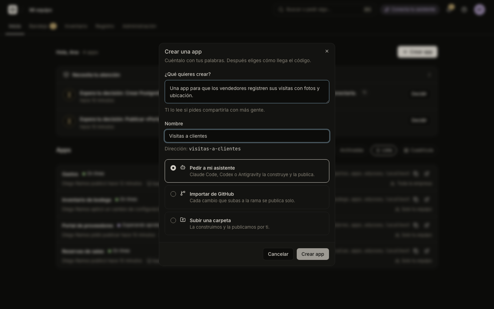
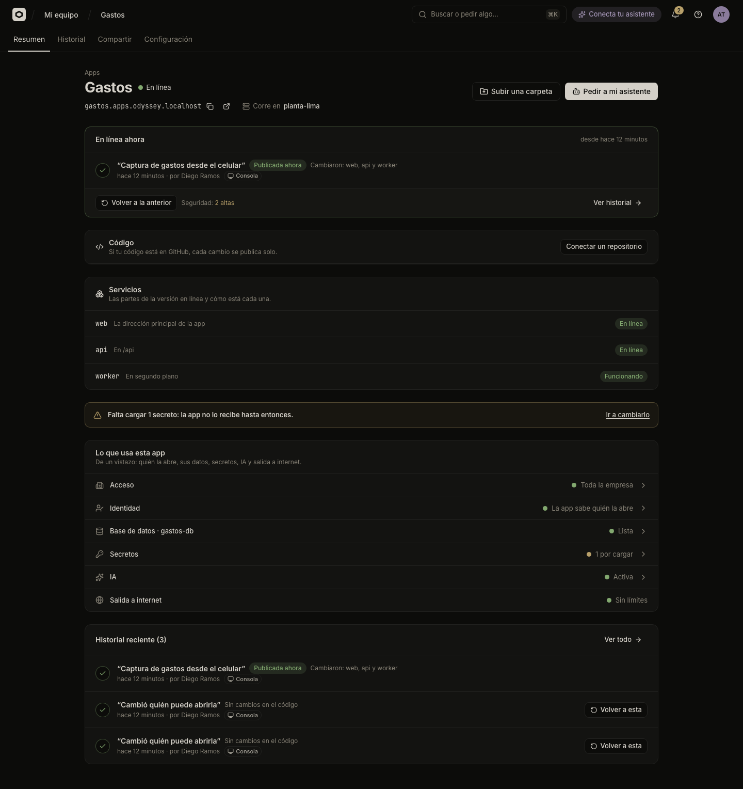

# Publish an app

You publish an app by creating it in Odicea and then getting its code online: ask your assistant, connect a GitHub repository, upload a folder, or publish an image that is already built. Odicea builds the code, checks that it answers and puts it online at its own address.

## Create an app

In **Inicio**, press **Crear app** (Create app), or ask your assistant to do it. Creating an app needs the permission to change apps (the Builder and TI roles).



In the **Crear una app** dialog:

| Field | What to write |
| :--- | :--- |
| **¿Qué quieres crear?** (What do you want to create?) | A sentence about the app. IT reads it if you later ask to share the app with more people. |
| **Nombre** (Name) | The app's name, for example "Gastos". Below it you see its address. |
| **Dirección (slug)** | Only with technical details on. 3 to 40 lowercase letters, numbers or hyphens. It cannot be changed after the app is created. |
| **Cómo llega el código** (How the code arrives) | One of three paths, below. |

The three paths:

| Path | What happens |
| :--- | :--- |
| **Pedir a mi asistente** | Odicea creates the app and shows you what to say to Claude Code, Codex or Antigravity. The assistant builds the app and publishes it. See [Connect your assistant](connect-an-assistant.md). |
| **Importar de GitHub** | You pick a repository and a branch; **Crear e importar** creates the app, connects the repository and publishes it. See [Publish from GitHub](github.md). |
| **Subir una carpeta** | **Crear y subir** creates the app and opens the upload. |

You can change path later. An app with no version shows **Publica la primera versión** (Publish the first version) with the same three paths: "Elige cómo llega tu código. Puedes cambiar de camino cuando quieras."

### With your assistant

You do not need to create the app first: from the app's folder, ask your assistant.

```text
Construye en esta carpeta una app para que mi equipo registre gastos de viaje.
Cuando funcione, publícala en la app Gastos de Odicea.
```

If the app does not exist, the assistant can create it. The assistant needs the Odicea connection and skill from [Connect your assistant](connect-an-assistant.md).

## Upload a folder

On the app's page press **Subir una carpeta** (Upload a folder). Drag your app's folder into the dialog, or press **Elegir carpeta** (Choose folder), then **Publicar**.



Your browser packs the folder and sends it; Odicea builds it. Things to know:

- **What is left out.** Folders that are rebuilt anyway are not sent: `node_modules`, `.git`, `.venv`, `venv`, caches such as `__pycache__` and `.cache`, and editor folders such as `.idea` and `.vscode`. In a JavaScript app, the output folders `dist`, `build`, `out` and `coverage` at the top are skipped too. Files named `.DS_Store` and `Thumbs.db` are skipped.
- **`.env` files are never uploaded.** The dialog warns you ("No subimos tus archivos .env."), because they may hold passwords. Set the app's settings in the console instead: see [Variables and secrets](variables-and-secrets.md).
- **Size limits.** The packed folder can be at most 100 MB, the unpacked one 500 MB, and the folder at most 20,000 files. Pick the app's folder only, without videos or backups.
- **Qué cambió** (What changed) is an optional sentence, up to 200 characters, that names the version in the history. It appears from the second version on.
- **Reconstruir todo** (Rebuild everything) builds again even if the code did not change. Use it when IT asks, for example to pick up a new base image.
- If the folder holds several apps, Odicea offers to publish them as separate parts. See [Apps with several parts](several-parts.md).

With technical details on, the dialog also asks for the **Puerto** (port) and the **Ruta de salud** (health path). Leave the defaults (8080 and `/`) unless your app listens elsewhere.

### With your assistant

```text
Publica los cambios de esta carpeta en la app Gastos de Odicea.
```

The assistant asks Odicea for a one-use upload link (valid for 10 minutes), runs the upload command in your folder, and follows the version until it is online. It sends the folder honoring your `.gitignore` and leaves out `.git`, `node_modules` and `.env*` files. It also gives the version a short name that describes the change.

## How Odicea builds your code

When the code arrives, Odicea decides how to build it:

- **Your own Dockerfile.** If there is a file named `Dockerfile` at the top of the folder, Odicea builds with it.
- **Railpack.** If there is none, Odicea detects the language and framework and prepares the build itself.

If it cannot work out how to build or start the app, the version fails and the build log says why. A `Dockerfile` in the folder tells Odicea exactly how to build it.

Your app must listen for web requests on the port in the `PORT` variable (8080 when none is set), on all network addresses, not only `localhost`. Odicea sets `PORT` for you.

### Watch the build

The page shows the steps of a version while it is published:

1. **Construyendo tu app** (Building your app)
2. **Preparando tu app** (Preparing your app)
3. **Revisando que funcione** (Checking that it works)
4. **Publicando** (Publishing)

Use **Ver cómo se construye** (See how it is built) to open the **Registro de la construcción** (Build log). With technical details on, it is open by default. When a version fails, read the log first: it shows the failing step. Your assistant can read the same log and fix the problem.

```text
La última versión de la app Gastos de Odicea no se publicó. Revisa qué pasó,
corrígelo en esta carpeta y vuelve a publicarla.
```

## Publish an image

If your team already builds container images, publish one directly. This is in the app's **Historial** tab, and it appears when technical details are on. It needs the permission to publish versions.

In **Publicar imagen** (Publish image), write the image, pinned by its digest, then press **Publicar**:

```text
ghcr.io/andes-logistica/gastos@sha256:…
```

The format is `registry/repository@sha256:<64 hex digits>`. Tags such as `:latest` are not accepted. Set **Puerto** and **Ruta de salud** if they differ from 8080 and `/`. An image published as it is has no build log and is not scanned for vulnerabilities.

With your assistant, ask for it with the digest; the assistant uses the "publish an image" tool, described in [MCP tools](../reference/mcp-tools.md).

## What "En línea" means

**En línea** (Online) means Odicea has a version of your app running, it passed its health check, and people with access can open it at the app's address. When you publish again, the new version is built and checked first. The old one stays online until the new one is ready. The page then says **Sigue en línea mientras tanto** (It stays online meanwhile).

### Health check and automatic restore

Before showing a version to anyone, Odicea asks the app a question: it requests the **health path** (`/` by default) and waits for a good answer. If the app never answers well, the version does not go online.

When a new version fails after it reached the servers, Odicea puts the version that was serving back, by itself. This is an **automatic restore**, shown in the history with the channel **Automático**. The page tells you: "La nueva versión no se publicó.", "Tu app sigue funcionando con la versión anterior." and "Nadie se vio afectado." If the build itself fails, nothing in the running app changed, so there is nothing to restore.

A version can also stop at **Esperando aprobación de TI** (Waiting for IT's approval) before it builds, when a rule asks for it. See [Approvals and the Bandeja](it/approvals.md) and [Versions and going back](versions.md).

## The app's address

Every app has an address made of its slug and your company's apps domain, for example `gastos.apps.example.com`. It shows in the app's header, with buttons to copy it and to open the app. The slug is chosen when you create the app and does not change. Who can open the address is set in the **Compartir** tab: see [Who can open an app](who-can-open-it.md).

## Who may do what

| Action | Permission |
| :--- | :--- |
| Create an app | `odyssey:projects:write` (Builder, TI) |
| Publish a version, upload a folder or an image | `odyssey:deployments:create` (Builder, TI) |
| Read versions and the build log | `odyssey:deployments:read` (all roles) |

The full list is in [Permissions](../reference/permissions.md). For what a version is and how it moves from request to online, read [The life of a version](../explanation/life-of-a-version.md).

## Next steps

- [Publish from GitHub](github.md) to publish on every push.
- [Variables and secrets](variables-and-secrets.md) to configure the app.
- [Your first app](../tutorials/first-app.md) for a guided walk.
