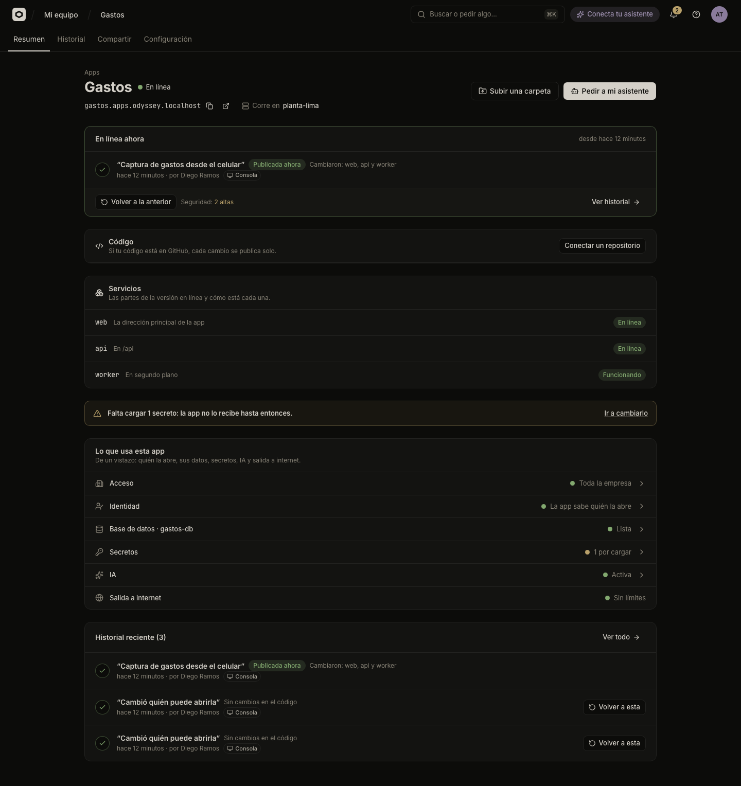

# Apps with several parts

Some apps are made of several programs in one code folder, such as a website, an API and a background worker. Odicea keeps them as one app, with one address and one history, and publishes them together.

If your code is a single app, you do not need this page: a new app has one part by default.

## When to use parts

Use parts when one repository (a monorepo) or one folder holds several apps in subfolders, for example:

```text
apps/web      the website
apps/api      the API
apps/jobs     a process that works in the background
```

Do not use parts to separate a website that your own backend already serves: that is one part.

## What a part is

Each part has:

| Field | Meaning |
| :--- | :--- |
| **Nombre** (Name) | Lowercase letters and numbers, up to 20, starting with a letter (`web`, `api`, `jobs`). |
| **Tipo** (Type) | **Web** answers pages or an API at the app's address. **En segundo plano** (In the background) has no address: it processes a queue or scheduled tasks. |
| **Carpeta** (Folder) | Where its code is, relative to the folder you publish. Empty means all of it. |
| **Ruta** (Route) | The part of the address it answers. `/` is the main address; `/api` answers everything that starts with `/api`. Empty keeps a web part internal: only the other parts see it. A background part has none. |
| **Recibe la ruta sin …** | Only for a route other than `/`. The part receives `/users` instead of `/api/users`. |

An app has between 1 and 8 parts, each route belongs to one part, and `/_odicea` is reserved for the platform.

Parts talk to the outside through the app's address. A browser reaches the API at `/api/...` on the same address.

## Create the parts

### In the console

**Detected automatically.** When you upload a folder or import a repository, Odicea looks at how the code is organized. If it finds several parts, it says "Encontramos N partes en tu código" and lists them. Leave **Publicarlas como partes separadas** (Publish them as separate parts) ticked to use them: "Cada una se construye desde su carpeta y todas salen juntas." You can change them later in **Configuración**.

**Afterwards.** On the app's **Configuración** tab, the **Servicios** (Services) panel lists the parts and has these buttons:

- **Detectar desde GitHub** (Detect from GitHub), when a repository is connected: reads the repository's file names and proposes the parts. It saves nothing by itself.
- **Editar** (Edit) or **Separar a mano** (Split by hand): opens **Partes de la app**, where you edit each part and press **Agregar una parte** (Add a part). **Guardar** saves.



### With your assistant

The assistant proposes the parts, shows them to you in plain words, and saves them when you agree.

```text
Mi repositorio tiene una web en apps/web, una API en apps/api y un proceso
en apps/jobs. Sepáralos en partes en la app Portal de proveedores de Odicea.
```

For a folder, run the assistant from the folder that contains all the parts (the repository root), not from inside one of them.

## How the parts ship together

- **One version for all.** A version holds every part as it was. Publishing builds each part from its own folder at the same time, and all of them go online together.
- **Only what changed is built.** Parts whose code did not change reuse what was built before. The version's history says which ones changed: "Cambió: api" or "Sin cambios en el código". **Reconstruir todo** builds all of them again.
- **Changes apply to the next version.** Saving new parts does not touch the version online: "Guardado. La próxima versión que publiques ya sale con estas partes." The exception is the first publication, which uses the parts you just accepted.
- **Going back goes back for all.** **Volver a esta** returns every part to how it was in that version, including the list of parts. See [Versions and going back](versions.md).
- **Connecting GitHub.** Connect the repository without a root folder: each part takes its own folder. Every push publishes the whole app. See [Publish from GitHub](github.md).

If IT's rules ask for approval to change an app's parts, the change waits in the **Bandeja**, and nothing changes until IT approves it. The console says: "Publica cuando lo aprueben: las partes de la app cambian recién entonces."

## Give something to only some parts

Variables, secrets, databases and AI can go to the whole app or only to chosen parts. In an app with several parts, the dialogs show **Quién lo recibe** (Who gets it). A variable that has the same name for one part and for the whole app takes the part's value. A files space goes to exactly one part. See [Variables and secrets](variables-and-secrets.md), [Databases and storage](storage.md) and [AI for your app](ai-for-apps.md).

## The state of each part

When an app has several parts, the **Resumen** tab has a **Servicios** panel with the state of each part of the version online:

| State | Meaning |
| :--- | :--- |
| **En línea** | The part answers. (A background part says **Funcionando** (Working), because it has no address to answer on.) |
| **Arrancando…** | Starting. |
| **No responde** | It started but does not pass the health check. |
| **No se pudo descargar** | The built image could not be fetched. |
| **Se detiene al arrancar** | The program keeps exiting right after starting. |
| **Falta configuración** | The cluster could not apply the app's settings. Ask IT. |
| **Espera un recurso** | It waits for a database or storage that is not ready. |
| **Sin noticias todavía** | The cluster has not reported yet. |

A part that fails makes the whole app appear under **Necesita tu atención**. With technical details on, each row also shows the exact state, the reason and how many copies are ready.

## When the cluster cannot run several parts

Running several parts needs support in the app's cluster. If it is missing, saving the parts fails with a message that the cluster cannot run several services yet. That is for IT to fix: see [Connect a cluster](it/clusters.md).

## Who may do what

| Action | Permission |
| :--- | :--- |
| See the parts | `odyssey:projects:read` (all roles) |
| Detect, save or change parts | `odyssey:projects:write` (Builder, TI) |

For the technical contract, see the API's services section in [the API contract](../api.md). The full list of permissions is in [Permissions](../reference/permissions.md).

## Next steps

- [Publish from GitHub](github.md)
- [Versions and going back](versions.md)
