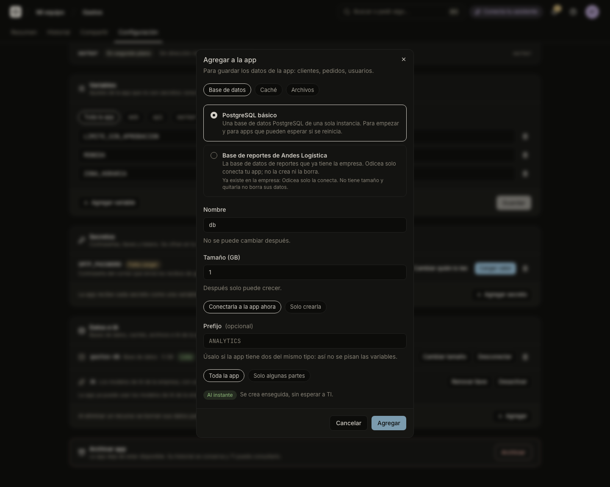

# Databases and storage

An app can have a database, a cache, a space for files, or a connection to storage your company already has. Odicea prepares it, gives the app the connection details as variables, and keeps them in step with the app.

## What you can add

What you can add depends on what IT offers for your app and what the app's cluster can prepare. The options are:

| In the console | What it is | Typical use |
| :--- | :--- | :--- |
| **Base de datos** (Database) | PostgreSQL | The app's data: customers, orders, users. |
| **Caché** (Cache) | Redis | Temporary data so the app answers faster. |
| **Archivos** (Files) | A persistent folder | Files the app saves and must keep. |
| **Almacenamiento de objetos** (Object storage) | An S3 bucket that already exists | Files kept in a bucket your company owns. |

If your cluster cannot prepare one of them, the dialog says so ("Por ahora esta app no puede agregar bases de datos, cachés ni archivos.") and lists the reason for each. That is for IT to fix. IT's own page about the options is [The catalog](it/catalog.md).

## Instant, needs approval, or not offered

Each choice carries a mark before you create it:

| Mark | Meaning |
| :--- | :--- |
| **Al instante** (Instantly) | "Se crea enseguida, sin esperar a TI." |
| **Pide aprobación** (Needs approval) | It is outside what IT lets you create at once, or IT's rules ask to approve it in this app. The button changes to **Pedir aprobación** (Ask for approval) and the resource is created when IT approves. Follow it in **Mis solicitudes** in the **Bandeja**. |
| **No disponible** (Not available) | IT's rules do not allow it in this app. |
| **Fuera del límite** (Out of limit) | A size is outside what your company allows. The message says the allowed range. |

An option IT does not offer for your app's level does not appear at all. A size that is inside IT's pre-approved range is instant; above it, it waits for approval. The same applies when you grow a resource.

## Add one

### In the console

1. Open the app, go to **Configuración**, and find **Datos e IA** (Data and AI).
2. Press **Agregar** (Add). The dialog is **Agregar a la app** (Add to the app).
3. Pick the **Tipo** (Type). If IT offers more than one option for it, pick an **Opción**.
4. Choose a **Nombre** (Name): lowercase letters, numbers and hyphens, starting with a letter, up to 30 characters. The console suggests `db`, `cache`, `archivos` or `objetos`.
5. Set the size if there is one, in GB. The dialog says whether it can change later: "Después solo puede crecer.", "No se puede cambiar después." or "Se puede cambiar después.".
6. Optionally, a **Prefijo** (Prefix) such as `ANALYTICS`, uppercase letters, numbers and `_`. See [The variables your app receives](#the-variables-your-app-receives).
7. Press **Agregar**.

An app can have up to 10 resources. The row shows **Preparando…** (Preparing), then **Lista** (Ready) and **Conectada a la app** (Connected to the app). If something goes wrong it shows **Falló** (Failed) with a plain explanation. For a resource the company already has, a failure is for IT to fix.



Adding a resource that is connected applies the change to the app with its new variables: the console says "Aplicando el cambio a la app…".

### With your assistant

```text
Agrégale una base de datos PostgreSQL de 5 GB a la app Gastos de Odicea
y úsala desde el código.
```

The assistant looks at what IT offers, creates the database and connects it. If the size needs approval, it tells you that the request is waiting for IT.

## The variables your app receives

The app gets the connection as environment variables, and the connection data is kept as a secret. You never see passwords in the console.

| Resource | Variables |
| :--- | :--- |
| Database | `DATABASE_URL` (the full address, with user and password), `PGHOST`, `PGPORT`, `PGDATABASE`, `PGUSER`, `PGPASSWORD`, and optionally `PGSSLMODE` |
| Cache | `REDIS_URL` |
| Files | `FILES_DIR`, the folder where the app saves files. It is `/data/<name>`, where `<name>` is the resource's name. |
| Object storage | `S3_BUCKET`, `S3_REGION`, and optionally `S3_ENDPOINT`, `AWS_ACCESS_KEY_ID` and `AWS_SECRET_ACCESS_KEY` |

With a prefix, every name starts with it: a database with prefix `ANALYTICS` gives `ANALYTICS_DATABASE_URL`, `ANALYTICS_PGHOST` and so on. Use a prefix when an app has two resources of the same kind. These variables win over a plain variable of the same name. With technical details on, the resource's row lists the exact names.

An app that has a file space starts one copy at a time. A new version stops the old copy before starting the new one, so there is a short pause.

## Resources the company already has

IT can register a database, a cache or a bucket that the company already runs. It then appears as an **Opción** with the note "Ya existe en la empresa: Odicea solo la conecta. No tiene tamaño y quitarla no borra sus datos." Odicea connects the app to it and does not create or erase it.

## Change a resource

- **Cambiar tamaño** (Change size) grows a resource. A size can only grow, and one above IT's pre-approved range needs approval.
- **Desconectar** (Disconnect) stops giving the variables to the app, and the resource stays. **Conectar** connects it again. In an app with several parts, you choose which parts receive it: see [Apps with several parts](several-parts.md).

## Delete a resource

Deleting is permanent, so it is treated with care:

1. Disconnect the resource first. One that the app still uses cannot be deleted ("La app la está usando. Desconéctala primero.").
2. Press the trash icon on its row. For a database, cache or file space you made, the dialog says "… y todo lo que guarda se borran para siempre. No hay forma de recuperarlos." and asks you to type the resource's name to confirm. Then press **Eliminar para siempre** (Delete forever).
3. For a resource the company already has, the dialog is **Quitar de la app** (Remove from the app): it only removes the connection. Its data stays where it is.

Deleting needs the permission `odyssey:resources:delete`, which Builder and TI roles have. Without it you do not see the delete button. There is no assistant tool to delete a resource; it is only done in the console.

## Who may do what

| Action | Permission |
| :--- | :--- |
| See an app's resources | `odyssey:projects:read` (all roles) |
| Add, resize, connect, disconnect | `odyssey:projects:write` (Builder, TI) |
| Delete | `odyssey:resources:delete` (Builder, TI) |
| Decide a request that needs approval | `odyssey:approvals:decide` (TI) |

The full list is in [Permissions](../reference/permissions.md). For the full contract of resources, see [resources](../resources.md) and [the catalog](../catalog.md).

## Next steps

- [Variables and secrets](variables-and-secrets.md) for the rest of the app's settings.
- [Approvals and the Bandeja](it/approvals.md) for how requests are decided.
