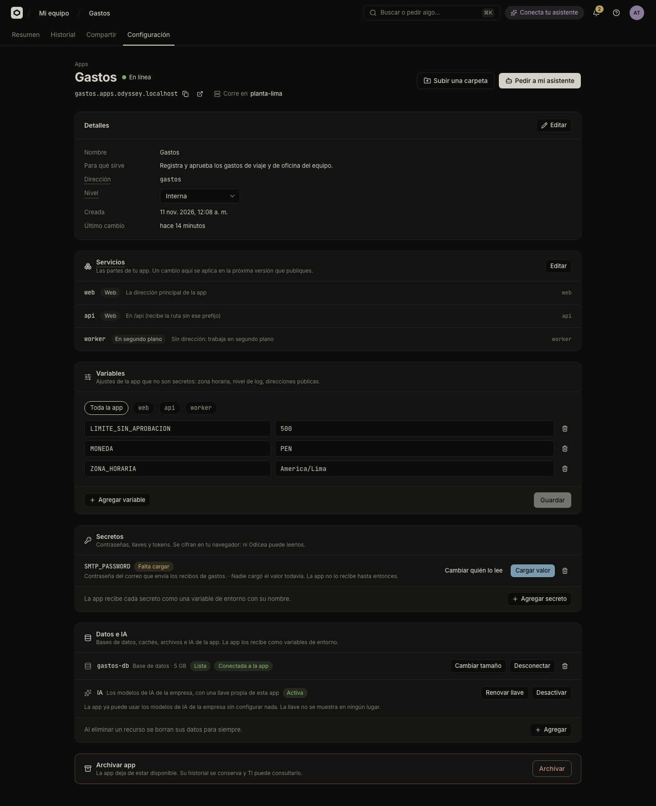

# Variables and secrets

Variables and secrets are the settings your app reads when it starts, such as a time zone or a payment key. Use a variable for anything that is not private and a secret for passwords, keys and tokens.



## Variables or secrets

| | Variable | Secret |
| :--- | :--- | :--- |
| For | Settings that are not private: time zone, log level, public addresses | Passwords, API keys, tokens |
| Who can read the value | Anyone who can see the app | Nobody, not even you, after it is saved |
| Where you set it | **Configuración**, panel **Variables** | **Configuración**, panel **Secretos** |
| How the app reads it | As an environment variable | As an environment variable |

Your code reads both the same way, for example `process.env.STRIPE_API_KEY` in Node or `os.environ["STRIPE_API_KEY"]` in Python.

If you write a variable whose name looks like a secret (it contains `PASSWORD`, `PASSWD`, `SECRET`, `TOKEN`, `PRIVATE_KEY`, `API_KEY`, `APIKEY` or `CREDENTIAL`), the console warns: "Cualquiera que vea la app puede leer una variable. Si es una contraseña, llave o token, guárdalo en Secretos."

Never put a secret in your code, in a `.env` file you upload, or in a message to your assistant. Uploads leave `.env` files out on purpose.

### Names

A name has letters, numbers and `_`, does not start with a number, and has up to 128 characters. Names that start with `ODYSSEY_` or `ODICEA_` are used by the platform and are refused. A name cannot be both a variable and a secret.

## Set variables

### In the console

1. Open the app, go to **Configuración** and find **Variables**.
2. Press **Agregar variable** (Add variable) and fill **Nombre** (name) and **Valor** (value). A value can have up to 4,096 characters.
3. Press **Guardar** (Save). **Descartar** (Discard) throws away your edits.

The trash icon next to a row removes the variable. In an app with several parts, a selector chooses **Toda la app** (the whole app) or one part. A part's own variable wins over one with the same name for the whole app. See [Apps with several parts](several-parts.md).

### With your assistant

```text
En la app Gastos de Odicea, pon la variable TZ en America/Lima
y LOG_LEVEL en info.
```

The assistant changes variables that are not secrets. If a value looks private, it should ask you to load it as a secret instead.

## Set secrets

A secret's value is encrypted in your browser before it leaves, so only the app's cluster can open it. Nobody can see it later, you included.

### In the console

1. In **Configuración**, find **Secretos** and press **Agregar secreto** (Add secret).
2. In **Agregar un secreto**, write the **Nombre** your code reads, for example `STRIPE_API_KEY`, and optionally **Para qué es** (What it is for), for example "Cobros con Stripe".
3. Press **Siguiente: cargar valor** (Next: load value). In the next dialog, type the **Valor** and save. The dialog tells you: "Se cifra en este navegador antes de salir: solo el clúster de la app puede abrirlo. Nadie podrá verlo después, ni tú."

A secret's value can be up to 64 KB. Each secret shows a state:

| State | Meaning |
| :--- | :--- |
| **Falta cargar** | Nobody loaded the value yet. The app does not receive it until then. |
| **Cargado** | The app receives it. |
| **Vuelve a cargarlo** | The cluster changed its key and cannot open the stored value. Load it again. |
| **No llegó** | The value did not reach the app's cluster. Load it again. |
| **No disponible** | The app's cluster cannot store this kind of secret yet. Ask IT to enable it. |
| **Bóveda de la empresa** | The cluster reads it from the company's store. |

On a loaded secret, **Cambiar valor** (Change value) replaces it and **Cambiar quién lo lee** (Change who reads it) chooses which parts of the app receive it, without loading the value again. For a secret that needs loading, the button reads **Cargar valor** or **Volver a cargar**.

### With your assistant

The assistant never sees a secret's value and you should not paste it in the chat. It asks Odicea for a loading request instead and gives you a link to the console.

```text
La app Gastos de Odicea necesita la llave de la API de Stripe. Prepara el
secreto STRIPE_API_KEY y dame el enlace para cargarlo.
```

You open the link, type the value in the console, and once it is loaded the app is published again with the secret.

## Secrets from the company's store

If IT connected a secret store (a vault), a person with the permission can point a secret to a value that lives there. Nobody copies the value through Odicea. In **Agregar un secreto**, a choice **De dónde sale el valor** (Where the value comes from) appears:

- **Lo cargo yo** (I load it): the flow above.
- **Bóveda de la empresa** (The company's vault): choose the **Almacén** (store), write the **Llave en la bóveda** (key in the vault), for example `apps/pagos/stripe`, and optionally a **Propiedad** (property). Press **Conectar** (Connect).

This option only appears if you have the permission `odyssey:secrets:external` (TI) and IT has registered at least one store. Without it, ask IT. Removing or replacing a secret that comes from the vault needs the same permission.

## When changes take effect

An app reads its variables and secrets when it starts, so a change needs a new version. You do not have to publish by hand:

- If the app is online, saving a change publishes the same version again with the new settings: the console says "Aplicando el cambio a la app…". The app stays online while it restarts.
- If the app has no version yet, the change is kept: "Guardado. La app lo recibe con la próxima publicación."

You can see that new version in the history as a version made by **Consola** or your assistant. See [Versions and going back](versions.md). If you remove a variable or secret, "La app deja de recibirlo. Si está en línea, se vuelve a publicar sin él."

An app can hold up to 100 variables, secrets and pending requests.

## Who may do what

| Action | Permission |
| :--- | :--- |
| See variables and secret names | `odyssey:projects:read` (all roles) |
| Change variables, load or remove secrets | `odyssey:projects:write` (Builder, TI) |
| Use or replace a secret from the company's store | `odyssey:secrets:external` (TI) |

Secret values are never shown to anybody. The full list is in [Permissions](../reference/permissions.md). For how secrets travel and are stored, read [the secrets contract](../secrets.md) and [Security model](../explanation/security-model.md).

## Next steps

- [Databases and storage](storage.md) give the app its connection variables for you.
- [AI for your app](ai-for-apps.md) adds the AI variables.
