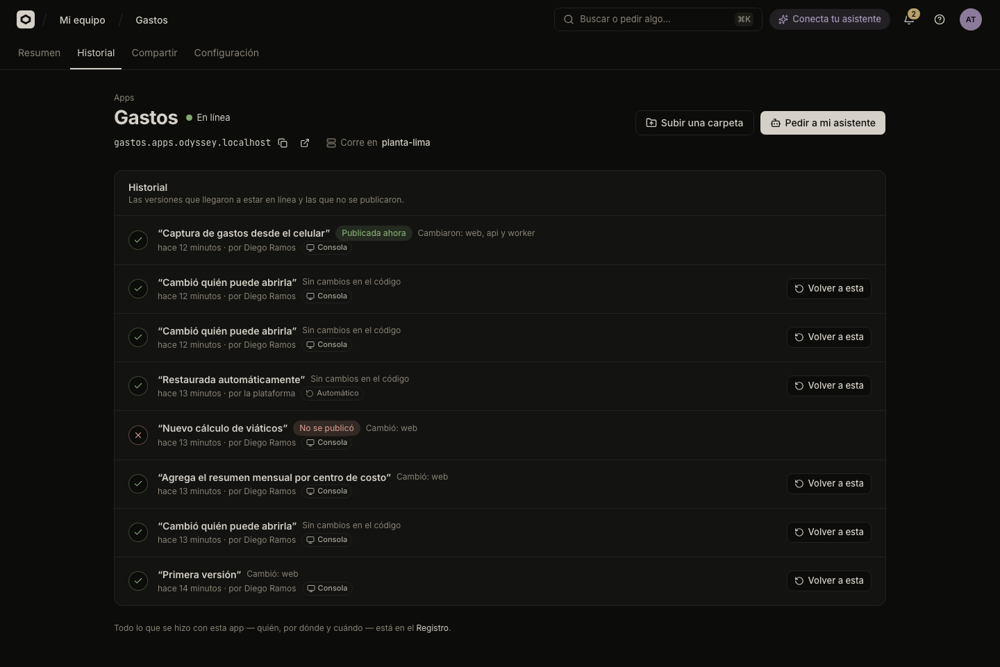
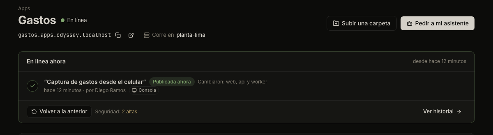

# Versions and going back

Every time you publish, Odicea makes a new version of your app and keeps the old ones. If a new version causes trouble, you can go back to an earlier one in a few clicks.

## What a version is

A version is the app as it was published at one moment: its code, its parts and its settings. Publishing again never changes an old version, and only one version is online at a time.

Odicea also makes a version when you change a setting of an app that is online, such as who can open it or a variable. These show in the history as "Cambió quién puede abrirla" or as a new version, so the history is the full story of what reached your app.

## The Historial

Open the app and go to **Historial** (History). Each row is a version, newest first:



| In the row | Meaning |
| :--- | :--- |
| Title | What changed. For a GitHub version, the commit's title. Otherwise the sentence written when it was published. A folder upload with no sentence reads "Subida desde una carpeta". |
| State | **Publicada ahora** (published now), **No se publicó** (failed) or **Esperando aprobación de TI** (waiting for IT's approval). Earlier versions that were online carry no label. |
| Who and when | The person, or "ti" if it was you, and how long ago. "la plataforma" for the automatic restores. |
| Channel | Where the request came from, below. |
| What changed | For an app with several parts, which parts changed ("Cambió: api"). See [Apps with several parts](several-parts.md). |

With technical details on, a row also shows the commit and branch for GitHub versions, the uploaded folder and the short identifier of the image.

Versions that were replaced by a newer one before they started, and ones still being built, are not listed: a version being built shows as progress on **Resumen**. The **Resumen** tab shows the newest few in **Historial reciente**, with a link to all of them.

### Which channel made it

Every version shows how it was requested. The channel comes from the system, not from what someone writes:

| Channel | Meaning |
| :--- | :--- |
| **Consola** (Console) | Someone pressed a button in the console. |
| **GitHub** | A push or **Publicar ahora** on a connected repository. |
| **Claude Code**, **Codex**, **Cursor**, **VS Code**, **Antigravity**, **Asistente** | An assistant did it with the person's permission. |
| **Automático** (Automatic) | Odicea itself, for an automatic restore. |
| **Canal no registrado** | Very old versions, before channels were recorded. |

The person shown is the one on whose behalf it was done. For GitHub pushes nobody asked for, it reads "tu equipo" if the name is not known.

IT sees every change of every app, with channel and person, in the audit log: see [Inventory and audit log](it/inventory-and-audit.md).

## Go back to a version

### In the console

1. Open **Historial**.
2. On the version you want, press **Volver a esta** (Go back to this one). Only an earlier version that went online before can be chosen.
3. Confirm in "¿Volver a …?" ("La publicamos de nuevo y, cuando esté lista, reemplaza a la actual. Si algo falla, la actual sigue en línea.").

The quick way is on **Resumen**: **Volver a la anterior** (Go back to the previous one) goes back to the newest earlier version that went online.

"Volviendo a esa versión…" appears and the version goes through the same steps as any publication, so it is checked before it replaces the current one. The history shows it as "Volviste a una versión anterior". In an app with several parts, every part goes back, including the list of parts.

Going back does not delete anything: the version you leave stays in the history, so you can return to it.

### With your assistant

```text
La última versión de la app Gastos de Odicea tiene un error. Vuelve a la
versión anterior que funcionaba.
```

The assistant shows you the versions and goes back to the one you pick.

## Automatic restore

If a new version reaches the servers but fails (it crashes or does not pass its health check), Odicea puts the version that was online back by itself. You see:

- "La nueva versión no se publicó."
- "Tu app sigue funcionando con la versión anterior."
- "Nadie se vio afectado."

and a version with channel **Automático** in the history. A version that fails while building never touches the running app, so no restore is needed. Details are in [Publish an app](publish.md#health-check-and-automatic-restore).

## Waiting for approval

IT can set rules that need a person's approval before some versions are published, for example when a version adds a public address in production. Such a version shows **Esperando aprobación de TI** and the app shows **Esperando aprobación**. Nothing is built or changed until IT decides, and the version that is online stays online.

Follow it in **Mis solicitudes** in the **Bandeja**. If IT approves, the version continues. If IT rejects it, it ends there and you can publish another. See [Approvals and the Bandeja](it/approvals.md).

## Seguridad (the security scan)

Right after Odicea builds your app, it looks for known security problems in it. On **Resumen**, under the version that is online, you see **Seguridad:** followed by the result:



| Result | Meaning |
| :--- | :--- |
| **Escaneando…** | The check is still running. |
| **Sin vulnerabilidades graves** | Nothing critical or high was found. |
| "1 crítica, 2 altas" | The number of critical and high findings. Critical ones are shown in red. |
| **No se pudo escanear** | The check could not run. The reason is in the app's detail. |
| **Sin escaneo** | An image published as it is, or built elsewhere, is not scanned. |

A critical finding appears under **Necesita tu atención** on **Inicio**, so someone can fix it and publish again. By default, IT's rules also block publishing to production a version that has critical findings. A scan that could not run does not block it unless IT turned on the rule that asks for approval in that case. See [Rules](it/rules.md) and [the scan contract](../scan.md).

## Who may do what

| Action | Permission |
| :--- | :--- |
| See versions and the security result | `odyssey:deployments:read` (all roles) |
| Publish a version | `odyssey:deployments:create` (Builder, TI) |
| Go back to a version | `odyssey:deployments:rollback` (Builder, TI) |
| Decide an approval | `odyssey:approvals:decide` (TI) |

The full list is in [Permissions](../reference/permissions.md). To understand every step a version takes, read [The life of a version](../explanation/life-of-a-version.md).

## Next steps

- [Publish an app](publish.md) for the steps of a publication.
- [Who can open an app](who-can-open-it.md) for the sign-in in front of it.
