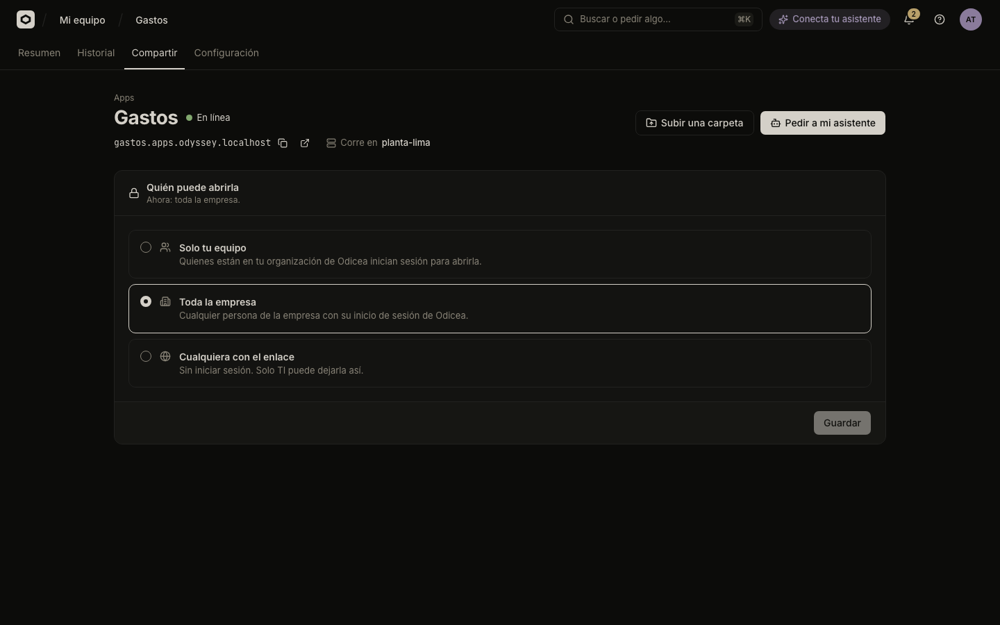

# Who can open an app

Every app has a setting that decides who may open it: only your team, everyone in the company, or anyone with the link. Odicea puts a sign-in in front of the app, so you do not build one yourself.



## The three choices

Open the app and go to **Compartir** (Share). The panel **Quién puede abrirla** (Who can open it) offers:

| Choice | Who can open the app | Sign-in |
| :--- | :--- | :--- |
| **Solo tu equipo** (Only your team) | People in your team in Odicea. | Yes |
| **Toda la empresa** (The whole company) | Any person of the company with their Odicea sign-in. | Yes |
| **Cualquiera con el enlace** (Anyone with the link) | Anyone who has the address, signed in or not. | No |

New apps start as **Solo tu equipo**. The panel's heading says what is in force now ("Ahora: solo tu equipo.") or, before the first version, what will apply when you publish ("Al publicarla: …").

## Sign-in in front of your app

For **Solo tu equipo** and **Toda la empresa**, a person who opens the app's address first signs in with their company account. Only then does Odicea pass the request to your app. Your app has no login page, no password handling and no user table to build.

The app can still know who is using it: Odicea adds the person's name and email to each request. See [Know who is using your app](identity-in-your-app.md).

> [!NOTE]
> With **Cualquiera con el enlace** there is no sign-in, so your app does not know who is using it. Do not put private data in an app like that.

## Change it

### In the console

1. Open **Compartir**.
2. Pick a choice.
3. Press **Guardar** (Save).

While the app is online, the change is applied to it right away: the button reads **Aplicando el cambio…** (Applying the change) and the app stays as it was until it is ready. A message "Cambiando quién puede abrirla…" confirms it. If the app has no version yet, the choice is stored and applied with the first publication.

If you cannot change apps, the choices are disabled. If you cannot make an app public, **Cualquiera con el enlace** is disabled.

### With your assistant

```text
Deja la app Gastos de Odicea abierta a toda la empresa.
```

```text
¿Quién puede abrir hoy la app Portal de proveedores?
```

## Making an app public needs approval

Making an app public removes the sign-in, so it is protected twice:

- Only people with the permission `odyssey:access:public` can choose it. By default that is IT (Ana Torres at Andes Logística, for example); builders see the choice disabled. With an assistant, the assistant has that permission only if the person who connected it has it and consented to it.
- By default, a rule asks IT to approve it. Instead of changing, the console says "Le pedimos a TI que lo apruebe." The app stays as it was until IT decides, and you follow the request in **Mis solicitudes** in the **Bandeja**. IT can change this rule; see [Rules](it/rules.md).
- Apps in a Sandbox level cannot be made public at all by default.

Going from public back to a sign-in choice is allowed to anyone who can change the app, even without the permission to make it public. Choosing public from another mode is the part that is controlled.

## When the choices are not available

The panel explains the cases in plain words:

- **"Este clúster todavía no puede pedir inicio de sesión: TI debe habilitarlo."** The app's cluster cannot put a sign-in in front yet, so the only choice left is **Cualquiera con el enlace**. Ask IT.
- **"La app se publica, pero nadie podrá iniciar sesión hasta que TI lo configure."** The server has no sign-in set up yet. Ask IT to enable it.
- **"Este cambio aún no llega a la app."** The change has not reached the app and nothing is on its way. It applies with the next publication, or when you publish the current version again.

## Who may do what

| Action | Permission |
| :--- | :--- |
| See who can open the app | `odyssey:projects:read` (all roles) |
| Switch between team and organization | `odyssey:projects:write` (Builder, TI) |
| Make an app public | `odyssey:access:public` (TI) |
| Decide the approval request | `odyssey:approvals:decide` (TI) |

The full list is in [Permissions](../reference/permissions.md). For how the sign-in works technically, read [Security model](../explanation/security-model.md) and [the access contract](../access.md).

## Next steps

- [Know who is using your app](identity-in-your-app.md) to use the signed-in person's identity in your code.
- [Approvals and the Bandeja](it/approvals.md) for what IT sees.
