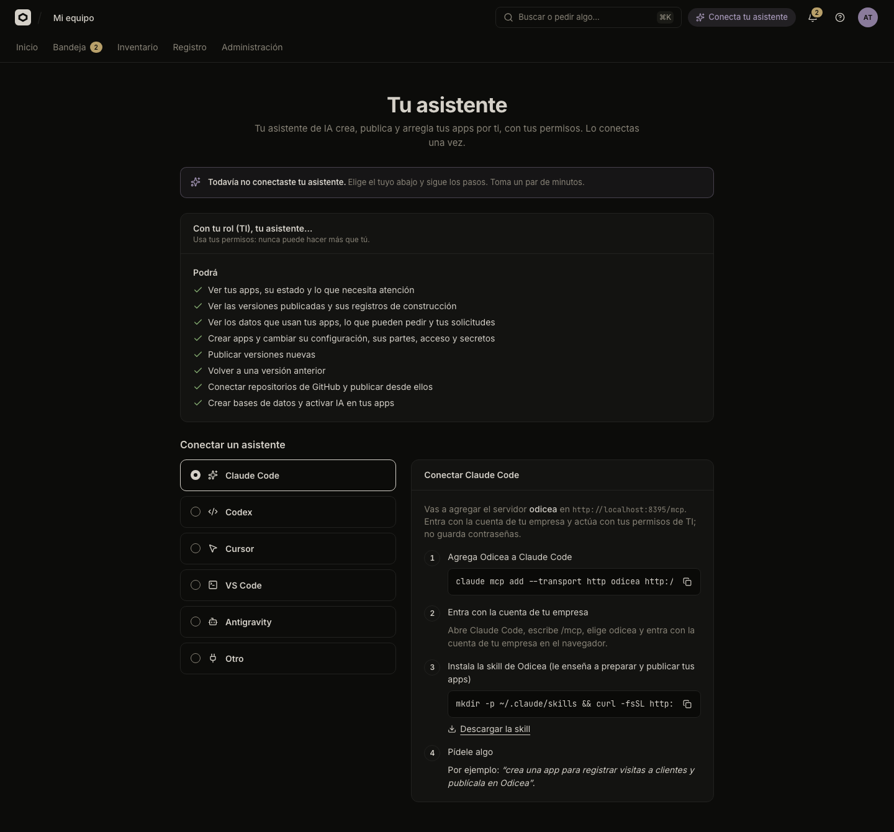

# Publish with your assistant

In this tutorial you connect Claude Code or Codex to your local Odicea, install the Odicea skill, and ask in Spanish for an app called Gastos to be created and published from a folder. Then you ask it to add a database, set a variable, request a secret and open the app to the whole company, and you compare what the assistant tells you with what the console shows. It takes about fifteen minutes and needs the local stack from the first tutorial.

You will end with an app published by your assistant, signed in as you and acting with your permissions, whose steps are attributed to the assistant in the company log.

## Before you start

- The local stack from [Your first app](first-app.md): `make dev` done, and `make run`, `make worker` and `make web` running.
- Claude Code or Codex installed on your computer.
- The demo user `ti@demo.local` and the `DEMO_PASSWORD` from `.env`.
- A small folder to publish. Make one now:

```sh
mkdir gastos && cd gastos

cat > package.json <<'EOF'
{
  "name": "gastos",
  "version": "1.0.0",
  "private": true,
  "scripts": { "start": "node index.js" }
}
EOF

cat > index.js <<'EOF'
const http = require('node:http')
const port = process.env.PORT || 8080
http.createServer((req, res) => {
  res.setHeader('content-type', 'text/plain; charset=utf-8')
  res.end(`Gastos de Andes Logística (zona horaria: ${process.env.TZ || 'sin definir'})\n`)
}).listen(port)
EOF
```

> [!NOTE]
> The API serves `/mcp` only when sign-in for assistants was provisioned: the seed that `make dev` runs does it and writes `IAMKIT_INTROSPECTION_CLIENT_ID` into `.env`. If the console says your IT has not enabled the assistant, run `make dev` again and restart `make run`.

## 1. Look at what the console offers

Sign in at <http://localhost:5178>, open the avatar menu and choose **Tu asistente**. The header chip "Conecta tu asistente" goes to the same page. The page says: "Tu asistente de IA crea, publica y arregla tus apps por ti, con tus permisos. Lo conectas una vez."



The section **Conectar un asistente** has one tab per assistant and four steps with the exact commands for your installation, using your API's own `/mcp` address (the screenshot was taken on another installation, so its port differs). They are the ones in the next two sections.

## 2. Connect it

Odicea has one MCP server, at `http://localhost:8095/mcp`. It is protected with OAuth: the assistant opens your browser, you sign in with the company account, and from then on every call carries your permissions, never more. Odicea does not store a password for the assistant.

For Claude Code:

```sh
claude mcp add --transport http odicea http://localhost:8095/mcp
```

Open Claude Code, type `/mcp`, choose `odicea` and sign in in the browser as `ti@demo.local`.

For Codex:

```sh
codex mcp add odicea --url http://localhost:8095/mcp
codex mcp login odicea
```

The second command opens the browser to sign in.

When it works, **Tu asistente** shows the panel **Conectado**, and a list headed "Con tu rol (TI), tu asistente…" with two parts, **Podrá** and **No podrá**. You can disconnect from there whenever you want.

## 3. Install the skill

The MCP server gives the assistant tools. The skill teaches it how to use them: how to prepare an app, what to ask you, how to diagnose a failure. Step 3 of the page has the command, which downloads the skill from your API. For Claude Code:

```sh
mkdir -p ~/.claude/skills && curl -fsSL http://localhost:8095/skills/odicea.tar.gz | tar -xz -C ~/.claude/skills
```

For Codex the folder is `~/.agents/skills`. The download is public (it needs no token) and the archive holds one folder, `odicea/`. Start a new session of your assistant afterwards so that it loads the skill.

## 4. Ask it to create and publish

Open your assistant in the `gastos` folder and say, in Spanish:

```text
Crea una app llamada Gastos y publica esta carpeta
```

This is the order the skill tells the assistant to follow:

1. `whoami` and `list_apps`: who it acts as, and whether Gastos already exists.
2. `create_app` with the name "Gastos". The answer has the app's short name (`gastos`) and a link to it in the console.
3. It prepares the app: port, health path and start command, with no secrets in the code.
4. `deploy_folder`, with a short message that becomes the version's name. This tool does not receive files: it returns a one-use upload command, valid for ten minutes, and the assistant runs it inside your folder. The upload leaves out `.git`, `node_modules` and `.env*` files.
5. `get_deployment`, waiting until the version is online, and then it gives you the address.

Your assistant may ask you to confirm some of these steps, such as running the upload command.

## 5. See it in the console

Open **Inicio**: **Gastos** is in the list of apps. Its header shows **En línea**, and **Historial** has a version named after the message the assistant wrote. While it was published you could see the same steps as in the first tutorial: **Construyendo tu app**, **Preparando tu app**, **Revisando que funcione** and **Publicando**.

Open **Registro** in the top bar. The entries for what the assistant did carry its channel, **Claude Code** or **Codex**. The **Canal** filter has, among others, "Consola", "Cualquier asistente" and one option per assistant ("Claude Code", "Codex"…), so you can tell what you did by hand from what the assistant did for you.

> [!NOTE]
> On the fake cluster the build is a script, and the address the assistant gives you is simulated: nothing answers on it. To open a real app, follow [Your first real cluster](first-real-cluster.md).

## 6. Add a database

Ask:

```text
Agrega una base de datos Postgres a Gastos
```

The assistant looks at what IT offers for this app with `list_catalog`, then calls `create_database` (or `create_resource` when it must choose a recipe or a size). On a cluster that can do it, the database is created and connected, the app is published again with `DATABASE_URL` and the `PG*` variables, and `list_resources` tells the assistant when the database is ready. The passwords never appear in the conversation.

On the stack of this tutorial this step cannot succeed. Databases are prepared by an agent running in a cluster, and the fake cluster has none, so the assistant gets a refusal from Odicea that says the cluster cannot create them and that this is IT's to fix. It should pass that on to you instead of retrying. In the console, **Configuración** shows the same limit in the panel **Datos e IA**: "El clúster de esta app todavía no puede crear bases de datos, cachés ni archivos. Pídele a TI que lo habilite." [Your first real cluster](first-real-cluster.md) does this step for real.

## 7. Set a variable

Ask:

```text
Define la variable TZ con el valor America/Lima
```

The assistant calls `set_env`. A variable is a setting that is not secret, such as a time zone. It is kept for every future version and, because the app is online, the same version is published again with the new setting. The assistant follows it with `get_deployment`. In **Configuración**, the panel **Variables** lists `TZ`. The assistant's answer lists names, never values.

## 8. Request a secret

Ask:

```text
Gastos necesita una llave SMTP_PASSWORD para enviar correos. Pídela
```

The assistant calls `request_secret` with the name and a short note about what it is for. It never sees or writes the value. It answers with a link into the console that it gives to you, of the form:

```text
<console>/apps/<id>?secret=SMTP_PASSWORD
```

Open it. In **Configuración**, the panel **Secretos** lists `SMTP_PASSWORD` with the badge **Falta cargar** ("Nadie cargó el valor todavía. La app no lo recibe hasta entonces.") and the dialog **Cargar valor** opens. Type any value and press **Guardar**. The browser encrypts it with the cluster's key before sending it, so neither Odicea nor the assistant can read it. The badge changes to **Cargado**, and Odicea publishes the app again with the secret as an environment variable of the same name.

Until you load it, the app keeps running as it was.

## 9. Open it to the whole company

By default an app can be opened only by your team, signing in with Odicea. Ask:

```text
Haz que Gastos la pueda abrir toda la empresa
```

The assistant calls `set_access` with the mode `organization`. Because the app is online, the same version is published again with the new setting. In **Compartir**, the panel **Quién puede abrirla** now says **Toda la empresa**. The third option, **Cualquiera con el enlace**, needs a permission that usually only IT has. If the assistant asks for it and it fails for that reason, it should tell you to ask IT rather than try another way.

## 10. Go back

Ask:

```text
Vuelve a la versión anterior de Gastos
```

The assistant calls `list_versions`, then `rollback`, and `get_deployment` to confirm. In **Historial** a new version, "Volviste a una versión anterior", is online. Nothing was erased.

## What the assistant shows and what the console shows

| | Your assistant | The console |
| :--- | :--- | :--- |
| What it is for | Asking in your own words and getting things done: create, publish, change, go back. | Seeing the state, reading the history, and the steps that must be yours. |
| Your permissions | It acts with yours: it can do what you can, no more. | The same permissions decide which tabs and buttons you see. |
| Secrets | It asks for one by name and never sees the value. | You type the value in **Cargar valor**; it is encrypted in your browser. |
| Databases and who can open an app | It asks, and reports what IT's rules or the cluster do not allow. | It shows the limits, and what waits for IT: "Esperando aprobación de TI". |
| Record | Each step is a tool call in its conversation. | **Registro** lists the same steps with the channel **Claude Code** or **Codex**. |

## If something went wrong

| Symptom | Cause |
| :--- | :--- |
| **Tu asistente** says "Tu equipo de TI todavía no habilitó el asistente." | The API has no sign-in for assistants. Run `make dev` again and restart `make run`. |
| The browser does not open when you connect | Run `/mcp` in Claude Code, or `codex mcp login odicea`, again. Sign in as `ti@demo.local`. |
| The assistant does not know how to prepare or publish the app | The skill is not installed, or the session started before you installed it. Run the command of step 3 and start a new session. |
| The upload command fails with an expired or used link | The link is single use and lasts ten minutes. Ask the assistant for a new `deploy_folder`. |
| The assistant says the cluster cannot create databases | Expected on the fake cluster. See [Your first real cluster](first-real-cluster.md). |
| `public` access fails | It needs the `odyssey:access:public` permission, which the demo user (role TI) has. With another user, ask IT. |
| The version stays on **Construyendo tu app** | The worker is not running. Start `make worker`. |

## What you learned

- One `claude mcp add` or `codex mcp add` connects an assistant to Odicea, and signing in once gives it your permissions and no more.
- The skill is what makes the assistant publish well: it prepares the app, writes the version name and diagnoses failures.
- Secrets travel from your browser to the cluster without passing through the assistant.
- The company log keeps the channel of each step, so you can tell the assistant's work from yours.

## Next steps

- [Connect your assistant](../guides/connect-an-assistant.md) for VS Code, Cursor and the details of each assistant.
- [The tools of the MCP server](../reference/mcp-tools.md), one by one.
- [Variables and secrets](../guides/variables-and-secrets.md) and [Who can open an app](../guides/who-can-open-it.md).
- [Your first real cluster](first-real-cluster.md): databases, scans and a working URL.
