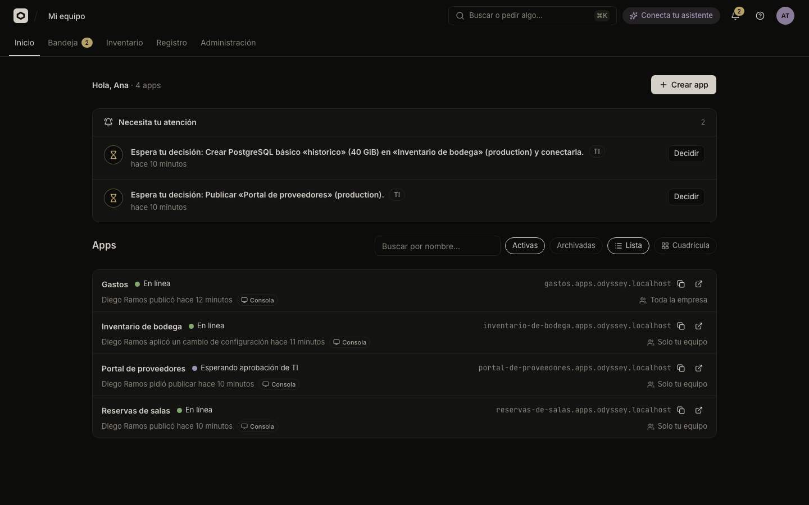
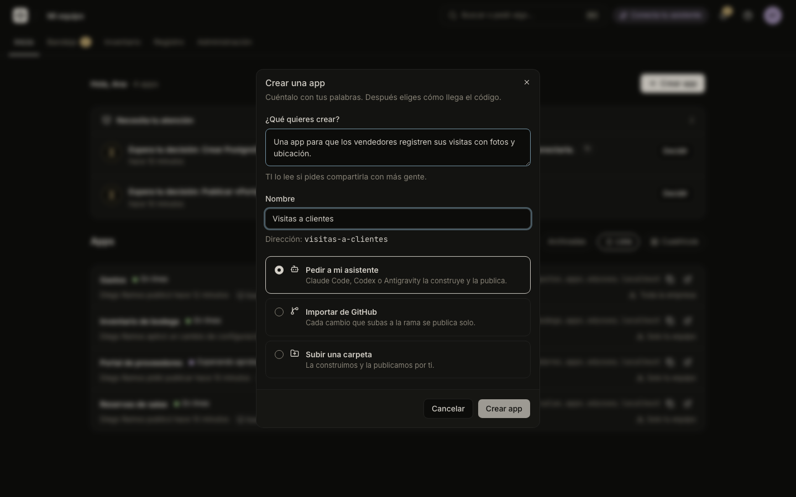
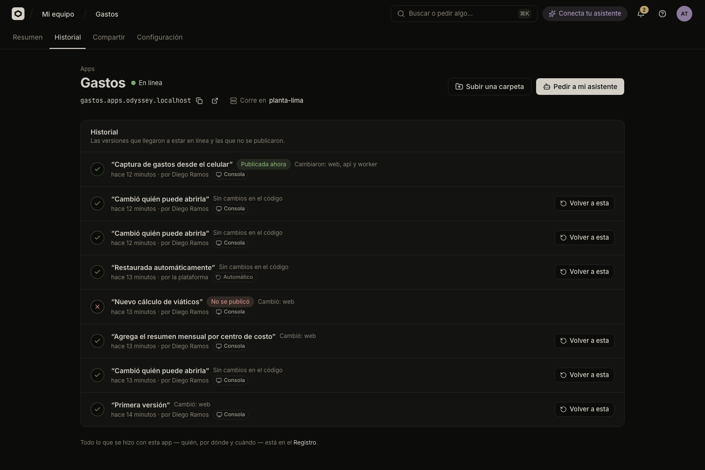

# Your first app

In this tutorial you start Odicea on your own computer, sign in to its console, create an app for Andes Logística, upload a small folder, watch it go online, publish a second version, go back to the first, and then break a version on purpose to see the platform restore the one that worked. It takes about twenty minutes, needs no Kubernetes and no cloud account, and every app runs on a simulated cluster that lives in memory.

You will end with an app called Portal de proveedores that has three versions in its history, one automatic restore, and a trail of all of it in the company log.

## Before you start

- Go (the version in `go.mod`), Docker, Node with `npx`, `jq` and `openssl`.
- A checkout of this repository and of [IAMKit](https://github.com/Abraxas-365/iamkit) (the sign-in service). `IAMKIT_SRC` in `.env` points at it; the default is `../../Desktop/Proyectos/iam`.
- Three free terminals (or tmux windows) for the API, the worker and the console.
- A browser. The console is in Spanish; this tutorial quotes its labels exactly.

> [!NOTE]
> Everything here runs on the **fake cluster**. Odicea builds nothing and starts no containers: it records the version, prints a scripted build log and reports the app as running. The address it shows for the app is simulated and nothing answers on it. [Your first real cluster](first-real-cluster.md) does the same with a real build and a real URL.

## 1. Start the stack

From the root of the repository:

```sh
make dev
```

This creates the secrets and the `.env` file, starts Postgres and IAMKit in Docker, and seeds a demo organization with one user, `ti@demo.local`. It takes two to four minutes the first time. Its password is the `DEMO_PASSWORD` line of `.env`:

```sh
grep DEMO_PASSWORD .env
```

Later runs only need `make up` to start the containers again.

> [!IMPORTANT]
> Once the seed exists, `make dev` and `make up` also start the compose `api`, `worker` and `gateway` containers, and the compose `api` takes port 8095. To run the processes on your machine as below, stop those three first and keep `db` and `iamkit`:
>
> ```sh
> docker compose stop api worker gateway
> ```

## 2. Run the API, the worker and the console

One command per terminal, from the root of the repository:

```sh
make run       # the API, on http://localhost:8095
make worker    # builds and publishes in the background; health on :8096
make web       # the console, on http://localhost:5178
```

Without `CLUSTER` and `BUILDER` set, both the API and the worker use the fake cluster and the fake builder. They must agree, so if you ever restart one with different settings, restart the other the same way.

## 3. Sign in

Open <http://localhost:5178>. The page says "Publica tus apps, de forma segura". Press **Entrar con mi cuenta**, and on the IAMKit page sign in with `ti@demo.local` and the password from step 1.

You land on **Inicio** with the greeting "Hola, …". The demo user has the role TI, which can create and publish apps, read the company log and change who can open an app.

Open the avatar menu and choose **Mostrar detalles técnicos**. It is a per-user setting that is off by default. It adds the fields and panels this tutorial needs later (the port and health path of an upload, and the panel to publish a ready-made image), and it opens the build log by default.

## 4. Create the app

On a new organization Inicio asks "¿Qué quieres crear?" with a **Continuar** button; once there are apps, use **Crear app** or the tile **Crear una app**. Either way the dialog **Crear una app** opens ("Cuéntalo con tus palabras. Después eliges cómo llega el código.").



Fill it in:

- **¿Qué quieres crear?**: `Un portal donde los proveedores de Andes Logística consultan sus pedidos`.
- **Nombre**: `Portal de proveedores`. The app's address, `portal-de-proveedores`, is derived from the name and shown under the field. With technical details on, you can edit it in **Dirección (slug)**.
- **Cómo llega el código**: choose **Subir una carpeta** ("La construimos y la publicamos por ti.").



Press **Crear y subir**. Odicea creates the app (private to your team by default) and opens its page with the upload dialog already open.

## 5. Make a tiny app and upload it

Odicea needs something to publish. In another terminal, outside the repository, make a folder with a web server that has no dependencies:

```sh
mkdir portal-de-proveedores && cd portal-de-proveedores

cat > package.json <<'EOF'
{
  "name": "portal-de-proveedores",
  "version": "1.0.0",
  "private": true,
  "scripts": { "start": "node index.js" }
}
EOF

cat > index.js <<'EOF'
const http = require('node:http')
const port = process.env.PORT || 8080
http.createServer((req, res) => {
  res.setHeader('content-type', 'text/plain; charset=utf-8')
  res.end('Portal de proveedores de Andes Logística\n')
}).listen(port, () => console.log(`escuchando en ${port}`))
EOF
```

In the upload dialog (**Subir una carpeta**), drop the folder on "Arrastra aquí la carpeta de tu app" or press **Elegir carpeta** and pick it. The console reads it ("Leyendo la carpeta…") and lists its files and size. Your browser packs the folder into a single archive: dependency and cache folders such as `node_modules` and `.git` are left out, and so are `.env` files, because they can hold passwords. The upload limit is 100 MB compressed.

With technical details on, the dialog also shows **Puerto** (8080, what the app listens on) and **Ruta de salud** (`/`, the path the platform calls to know the app is up). The sample app already fits both. Press **Publicar**.

> [!NOTE]
> With the fake builder the contents of the folder do not matter: nothing reads `index.js`. Keep a real app in it anyway; the same folder is what a real cluster would build.

## 6. Watch it go online

The page shows **Publicando una nueva versión** ("Tu app sigue funcionando con la versión actual hasta que la nueva esté lista.") with four steps:

1. **Construyendo tu app**
2. **Preparando tu app**
3. **Revisando que funcione**
4. **Publicando**

Open **Ver cómo se construye** (it is open already in technical mode). The fake builder prints a scripted log, nothing more:

```text
↳ descargando el código
↳ detectando el tipo de app
#1 [internal] load build definition
#2 [internal] load metadata
#3 install dependencies
#4 build
#5 exporting to image
```

The fake build lasts about eight seconds, and the log fills in as it goes. Then the app header shows **En línea**, and the panel **En línea ahora** appears on **Resumen**. The fake builder does not scan images, so the footer reads "Seguridad: No se pudo escanear": the scan is recorded as unsupported with the message "Este clúster no revisa vulnerabilidades." A real cluster scans every build; you will see that in [Your first real cluster](first-real-cluster.md).

## 7. Publish a second version

Change the sample app:

```sh
sed -i.bak 's/Portal de proveedores de Andes Logística/Portal de proveedores de Andes Logística (v2)/' index.js && rm index.js.bak
```

Back on the app, press **Subir una carpeta**, pick the folder again and fill in **Qué cambió (opcional)**: `Muestra la versión en la portada`. It is the name this version has in the history. The checkbox **Reconstruir todo** forces a build from scratch; leave it off. Press **Publicar**.

While the new version is built the old one stays online: the panel says "Sigue en línea mientras tanto". When it is ready it replaces the old one.

## 8. Go back to the first version

Open **Historial**. Each version has a name in quotes, and the one online has the badge **Publicada ahora**:

- "Muestra la versión en la portada" (the second upload, online now);
- "Subida desde una carpeta" (the first upload: a folder uploaded without a message gets that name).



On the first version press **Volver a esta**. The dialog asks `¿Volver a “Subida desde una carpeta”?` and explains: "La publicamos de nuevo y, cuando esté lista, reemplaza a la actual. Si algo falla, la actual sigue en línea." Confirm with **Volver a esta**. The toast says "Volviendo a esa versión…" and a new version appears in the list named "Volviste a una versión anterior". Going back never rewrites history: it publishes the old version again as a new one.

## 9. Break a version on purpose

On the fake cluster an image whose repository name contains `unhealthy` starts but never answers its health check, and one containing `reject` is refused outright. You can publish a ready-made image from **Historial**, in the panel **Publicar imagen** ("Una imagen ya construida, fijada por digest."). The panel is only visible with technical details on.

Fill it in:

- **Imagen**: `ghcr.io/andes-logistica/portal-unhealthy@sha256:0123456789abcdef0123456789abcdef0123456789abcdef0123456789abcdef`
- **Puerto**: `8080`
- **Ruta de salud**: `/`

The image must be `registry/repository@sha256:` followed by 64 hexadecimal characters. A tag such as `:latest` is rejected, because a tag can change under you. Press **Publicar**.

Watch the steps. The third one, **Revisando que funcione**, fails. Your app never went down: the page shows a warning, "Tu app sigue funcionando con la versión anterior.", with the reason "La app arrancó pero no responde en su ruta de salud." and "Nadie se vio afectado." In **Historial** the broken version has the badge **No se publicó**. Right after, the platform publishes a new version named "Restaurada automáticamente", with the same content as the one that was online, and it takes the badge **Publicada ahora**.

## 10. Read the trail

Open **Registro** in the top bar (it needs the permission to read the company log, which TI has). Each line says who did what, from which channel and when. For this tutorial you will find sentences such as:

```text
Empezó a publicar Portal de proveedores en production
Portal de proveedores quedó en línea en production
Volvió a una versión anterior de Portal de proveedores en production
Falló la publicación de Portal de proveedores en production: La app arrancó pero no responde en su ruta de salud.
Restaurando la versión anterior de Portal de proveedores en production
Se restauró la versión anterior de Portal de proveedores en production
```

Your own actions carry the channel **Consola**; the restore carries **Automático**, because the platform did it. The **Canal** filter lists these channels. From an app's **Historial**, the link **Registro** at the bottom opens the log filtered to that app.

## If something went wrong

| Symptom | Cause |
| :--- | :--- |
| `make dev` cannot start IAMKit | `IAMKIT_SRC` in `.env` does not point to an IAMKit checkout. Fix the path and run `make dev` again. |
| The folder upload fails to build on the fake builder | The fake builder refuses a folder whose name contains `unsupported`, to simulate an app with no start command. Rename the folder. |
| The sign-in page rejects the password | Use `ti@demo.local` and the `DEMO_PASSWORD` value in `.env`, not a password you chose. |
| The console loads but nothing responds | The API is not running. Start `make run`, and check that `make up` started Postgres and IAMKit. |
| The version stays on **Construyendo tu app** | The worker is not running. Start `make worker`. |
| You do not see **Publicar imagen** | Turn on **Mostrar detalles técnicos** in the avatar menu. |
| The image is refused before publishing | It is not `registry/repository@sha256:<64 hex characters>`. Tags are not accepted. |
| A version says **No se publicó** after a normal upload | The warning on **Resumen** gives the reason. Using `unhealthy` or `reject` in an image name causes this on purpose. |
| There is no **Registro** in the top bar | Your user lacks the permission to read the company log. The demo user has it. |
| Opening the app's address shows nothing | Expected on the fake cluster: the address is simulated. Use a real cluster for a working URL. |

## What you learned

- `make dev`, `make run`, `make worker` and `make web` give you the whole platform on your computer, with a fake cluster that needs nothing else.
- You create an app, upload a folder and the platform builds and publishes it as a version, keeping the previous one online until the new one answers.
- **Volver a esta** publishes an old version again; a version that fails its health check is replaced automatically by the one that worked.
- **Registro** keeps who did what, and through which channel.

## Next steps

- [Publish with your assistant](first-app-with-an-assistant.md): do the same by asking Claude Code or Codex.
- [Your first real cluster](first-real-cluster.md): real builds, a real scan and a real URL on k3d.
- [Publish an app](../guides/publish.md) and [Versions and going back](../guides/versions.md) for everything these steps touched.
- [Local development](../guides/operations/local-development.md) for the full list of local services and ports.
